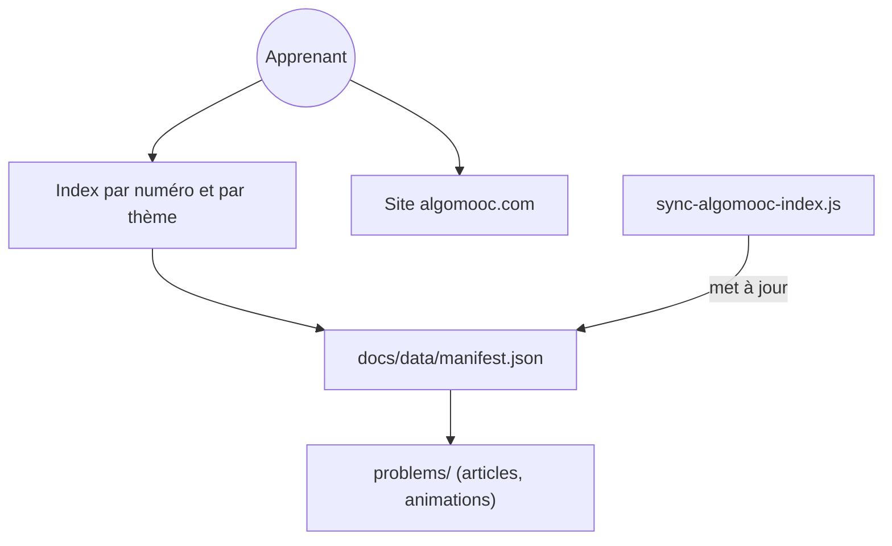

# MisterBooo/LeetCodeAnimation

> Index and archives of animations explaining LeetCode solutions, in Chinese, for learning algorithms.

## The problem
Reading a LeetCode solution does not show how the pointers move. The animation makes the algorithm visible step by step.

## What it actually does
The repository keeps an index by number and by theme, older articles and GIFs, and a manifest `docs/data/manifest.json` (256 problems). The full experience (steps, voice, the "小欧" assistant, Python, C++ and Java code) lives on the algomooc.com site. Scripts synchronize the index from the site.

## How it is wired


## Trying it
```bash
npm run review:site
npm run sync
npm run validate
node tools/scripts/build-readme.js --write
```

## Cost and gotchas
These commands are for maintainers. To read, GitHub is enough, but the rich content is on a third-party site. The content is in Chinese; an English version exists in `docs/README-En.md`.

## What it is not
Not a standalone course: most of the recent animations are on the site, not in the repository. The figure 299 counts the whole site, 256 the repository's subset.

## Alternatives
No alternative named in the README.

## For you
Ignore it: competitive-programming algorithm practice, outside your data and MLOps work.
