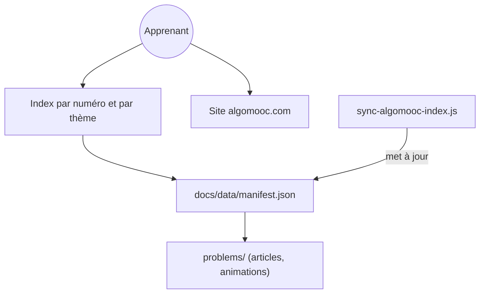

# MisterBooo/LeetCodeAnimation

> Index et archives d'animations expliquant des solutions LeetCode, en chinois, pour apprendre les algorithmes.

## Le problème
Lire une solution LeetCode ne montre pas comment les pointeurs bougent. L'animation rend l'algorithme visible pas à pas.

## Ce que ça fait vraiment
Le dépôt garde un index par numéro et par thème, des articles et GIF anciens, et un manifeste `docs/data/manifest.json` (256 problèmes). L'expérience complète (étapes, voix, assistant « 小欧 », code Python, C++ et Java) vit sur le site algomooc.com. Des scripts synchronisent l'index depuis le site.

## Comment c'est branché


## Essayer
```bash
npm run review:site
npm run sync
npm run validate
node tools/scripts/build-readme.js --write
```

## Coût et pièges
Ces commandes servent aux mainteneurs. Pour lire, il suffit de GitHub, mais le contenu riche est sur un site tiers. Le contenu est en chinois ; une version anglaise existe dans `docs/README-En.md`.

## Ce que ce n'est pas
Pas un cours autonome : l'essentiel des animations récentes est sur le site, pas dans le dépôt. Le chiffre 299 compte le site entier, 256 le sous-ensemble du dépôt.

## Alternatives
Aucune alternative nommée dans le README.

## Pour toi
À ignorer : entraînement d'algorithmes de concours, hors de ton travail data et MLOps.

