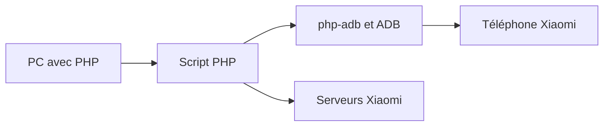

# MlgmXyysd/Xiaomi-HyperOS-BootLoader-Bypass

> Proof of concept that bypasses a Xiaomi restriction on unlocking the HyperOS bootloader.

## The problem
Xiaomi limits bootloader unlocking on its phones to eligible accounts and devices. The author disputes this policy.

## What it actually does
It is a PHP (8.0+) script that relies on the php-adb library and on ADB. It exploits a flaw to bypass HyperOS's account/device binding restriction. The waiting periods on the MIUI side still apply. The README lists the error codes and the conditions: valid SIM card, non-banned Xiaomi account, monthly and yearly quotas.

## How it is wired

## Trying it
The README describes installing PHP 8.0+, ADB (platform-tools) and the script, but gives no exact launch command. None is reproduced here: the tool bypasses a manufacturer security measure.

## Cost and gotchas
Free, but the README warns: loss of warranty, data loss, risk of account or device ban, TEE functions permanently altered. No license declared, 163 open issues.

## What it is not
Not an official tool and not a full unlocker: it does not replace Xiaomi's tool. It may breach the manufacturer's terms; it should only be used on a device you own.

## Alternatives
None named in the README (apart from Xiaomi's official unlock tool).

## For you
Ignore: outside your data/AI/MLOps scope, it bypasses a manufacturer protection with no declared license, with a real risk to the device and the account.
