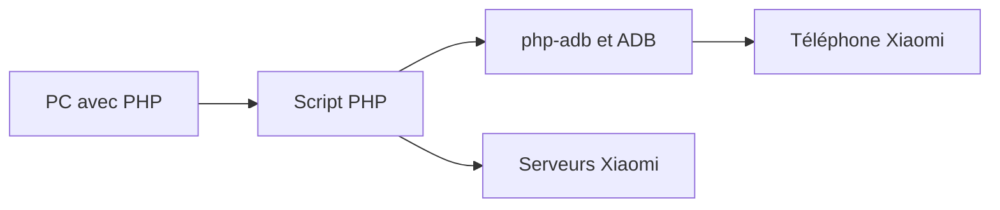

# MlgmXyysd/Xiaomi-HyperOS-BootLoader-Bypass

> Preuve de concept qui contourne une restriction de Xiaomi sur le déverrouillage du bootloader HyperOS.

## Le problème
Xiaomi limite le déverrouillage du bootloader de ses téléphones à des comptes et appareils éligibles. L'auteur conteste cette politique.

## Ce que ça fait vraiment
C'est un script PHP (8.0+) qui s'appuie sur la bibliothèque php-adb et sur ADB. Il exploite une faille pour contourner la restriction de liaison compte/appareil de HyperOS. Les délais d'attente côté MIUI restent applicables. Le README liste les codes d'erreur et les conditions : carte SIM valide, compte Xiaomi non banni, quotas par mois et par an.

## Comment c'est branché

## Essayer
Le README décrit une installation de PHP 8.0+, d'ADB (platform-tools) et du script, mais ne donne pas de commande de lancement exacte. Aucune n'est reproduite ici : l'outil contourne une mesure de sécurité du constructeur.

## Coût et pièges
Gratuit, mais le README avertit : perte de garantie, perte de données, risque de bannissement du compte ou de l'appareil, fonctions TEE définitivement altérées. Aucune licence déclarée, 163 issues ouvertes.

## Ce que ce n'est pas
Pas un outil officiel et pas un déverrouilleur complet : il ne remplace pas l'outil Xiaomi. Il peut contrevenir aux conditions du constructeur ; il ne doit servir que sur un appareil dont on est propriétaire.

## Alternatives
Aucune nommée dans le README (hors outil de déverrouillage officiel de Xiaomi).

## Pour toi
À ignorer : hors de ton périmètre data/IA/MLOps, il contourne une protection constructeur sans licence déclarée, avec un risque réel sur l'appareil et le compte.

