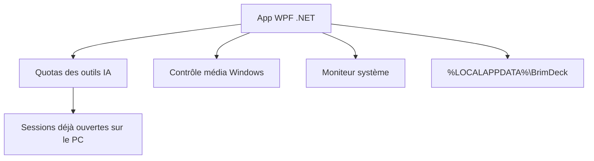

# MoFeng2223/BrimDeck

> Dynamic island for Windows 11 that groups AI coding tool quotas, music and system monitor.

## The problem
Checking the quotas of Claude, Codex or Cursor means opening each site, command line or application.

## What it actually does
A panel at the top of the screen (notch, capsule or indicator) shows quotas, tokens and estimated cost per tool over 7 days, up to seven tools. It detects the tools already signed in on the PC. It adds media control with lyrics, a system monitor (CPU, GPU, memory, network, temperatures, power) and themes. It hides itself during full-screen games.

## How it is wired
Simplified diagram based on the sheet, no diagram provided.



## Trying it
```text
Télécharger BrimDeck-<version>-Setup.exe ou BrimDeck-<version>-Portable-x64.zip
depuis Releases, puis lancer BrimDeck.exe.
Si Windows affiche « Windows protected your PC » : More info, puis Run anyway.
```

## Cost and gotchas
Free. Windows 11 x64 (Windows 10 limited). The displayed cost is an estimate, not your bill. It reads the sign-in states already present; tokens stay in memory.

## What it is not
It is not a billing tool nor a client for these services. It does not exist on macOS or Linux. Two-month-old repository.

## Alternatives
No alternative named in the README.

## For you
Worth watching: useful if you use several AI coding tools on Windows and want to track your quotas at a glance.
