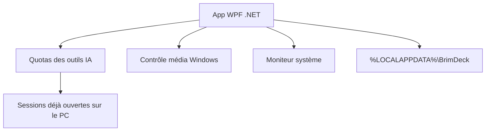

# MoFeng2223/BrimDeck

> Îlot dynamique pour Windows 11 qui regroupe quotas d'outils IA de code, musique et moniteur système.

## Le problème
Vérifier les quotas de Claude, Codex ou Cursor oblige à ouvrir chaque site, ligne de commande ou application.

## Ce que ça fait vraiment
Un panneau en haut de l'écran (notch, capsule ou indicateur) affiche les quotas, les jetons et le coût estimé par outil sur 7 jours, jusqu'à sept outils. Il détecte les outils déjà connectés sur le PC. Il ajoute contrôle média avec paroles, moniteur système (CPU, GPU, mémoire, réseau, températures, puissance) et thèmes. Il se masque pendant les jeux plein écran.

## Comment c'est branché
Schéma simplifié d'après la fiche, sans diagramme fourni.



## Essayer
```text
Télécharger BrimDeck-<version>-Setup.exe ou BrimDeck-<version>-Portable-x64.zip
depuis Releases, puis lancer BrimDeck.exe.
Si Windows affiche « Windows protected your PC » : More info, puis Run anyway.
```

## Coût et pièges
Gratuit. Windows 11 x64 (Windows 10 limité). Le coût affiché est une estimation, pas ta facture. Il lit les états de connexion déjà présents ; les jetons restent en mémoire.

## Ce que ce n'est pas
Ce n'est pas un outil de facturation ni un client de ces services. Il n'existe pas sur macOS ni Linux. Dépôt de deux mois.

## Alternatives
Aucune alternative nommée dans le README.

## Pour toi
À surveiller : utile si tu utilises plusieurs outils IA de code sous Windows et veux suivre tes quotas d'un coup d'œil.

