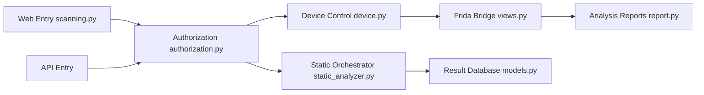

# MobSF/Mobile-Security-Framework-MobSF

> Security analysis platform for Android, iOS and Windows mobile applications, for researchers and CI teams.

## The problem
Auditing a mobile application (binary or source code) requires chaining static analysis tools, runtime instrumentation and reporting, without a common framework.

## What it actually does
Django application: you submit an APK, IPA, APPX or source code through the web interface or the REST API. Static analysis parses the artifacts, applies security and malware checks, and stores the results. Dynamic analysis (Android and iOS) drives a device or Corellium, injects Frida scripts and can observe network traffic. Reports are generated; the README announces CI/CD integration through API and CLI. The architecture diagram itself acknowledges a degree of inference.

## How it is wired


## Trying it
```bash
docker pull opensecurity/mobile-security-framework-mobsf:latest
docker run -it --rm -p 8000:8000 opensecurity/mobile-security-framework-mobsf:latest

# Default username and password: mobsf/mobsf
```

## Cost and gotchas
Free, GPL-3.0 license (copyleft). Docker required for the quick route. Default credentials mobsf/mobsf: change them before any network exposure. Dynamic analysis assumes a device, an emulator or Corellium, not detailed in the README.

## What it is not
Not a scanner to run on applications you have no right to analyze: the README talks about research, penetration testing and malware analysis, which assumes an authorized setting. The README is brief (the illustration sections are empty here); the detail is in the external documentation.

## Alternatives
- mobsfscan: the project's variant for CI/CD integration.
- mobsf.live: online version of the static analyzer.

## For you
Watch: relevant only if you audit mobile applications or integrate mobile security into CI; otherwise, no link with a data/AI workflow.
