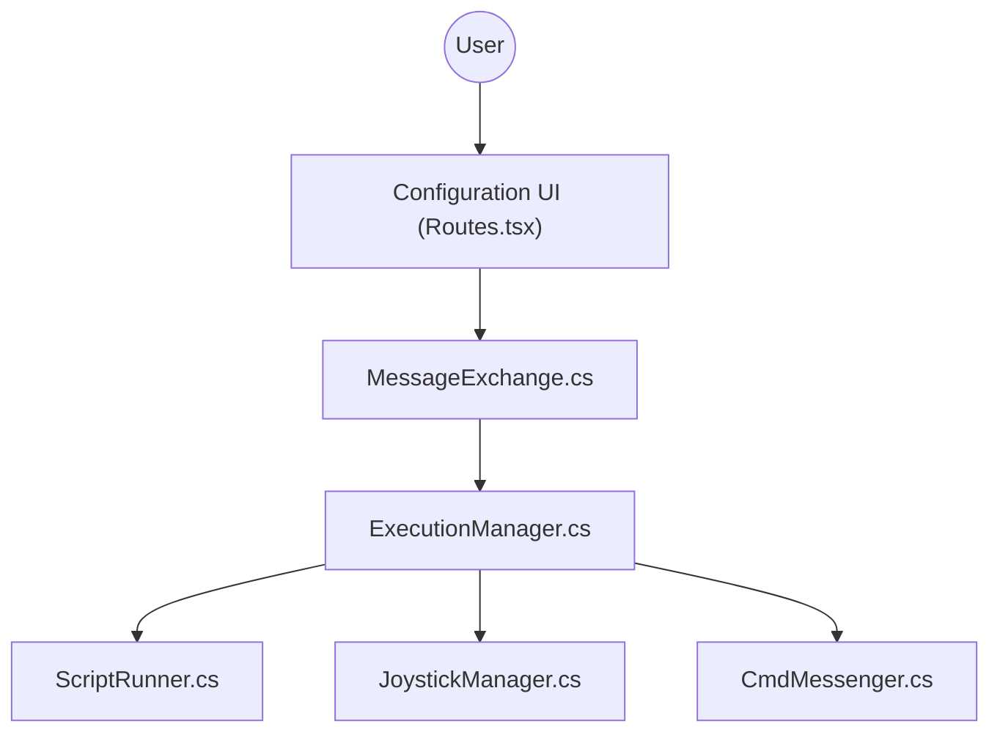

# MobiFlight/MobiFlight-Connector

> Windows application that links flight simulators to home-built hardware: buttons, displays, LEDs, Arduino boards.

## The problem
Connecting physical instruments to a flight simulator normally requires programming every link.

## What it actually does
The configuration UI defines projects and actions. The connector runs these configurations, reads the hardware inputs and writes the values into MSFS, X-Plane, FSX or P3D. It also handles USB joysticks and MIDI controllers. A serial messaging layer talks to the boards.

## How it is wired
Diagram based on the code diagram.

## Trying it
No documented commands. The README points to the download on mobiflight.com.

## Cost and gotchas
Free. Windows, a compatible simulator and hardware. The repo is in C# with an embedded web interface.

## What it is not
It is not a simulator. You must already own the hardware and the simulator.

## Alternatives
No alternative named in the README.

## For you
Ignore: a flight-simulation hobby, unrelated to data or AI.
