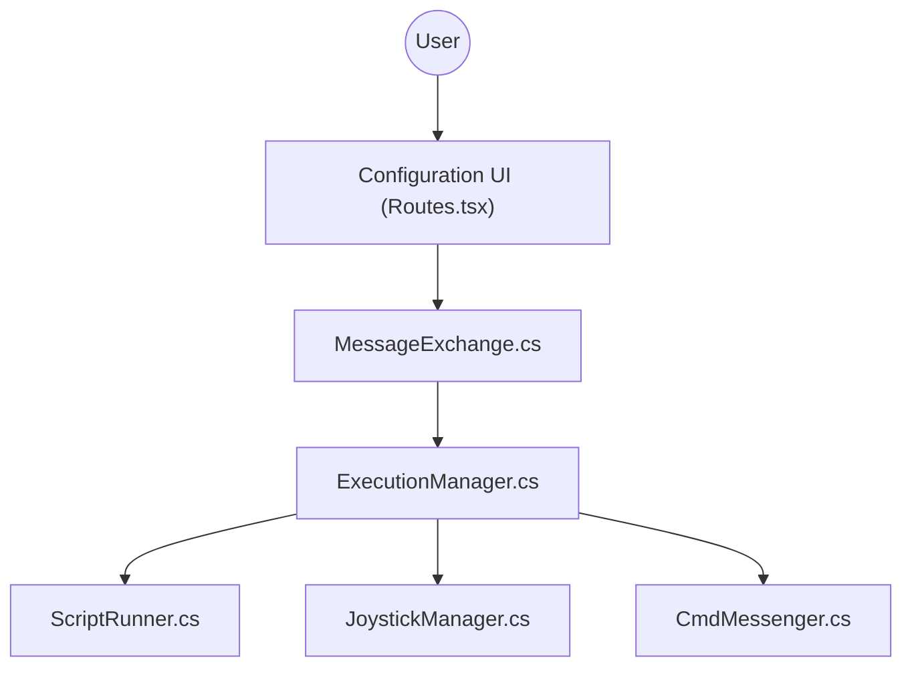

# MobiFlight/MobiFlight-Connector

> Application Windows qui relie simulateurs de vol et matériel maison : boutons, afficheurs, LED, cartes Arduino.

## Le problème
Brancher des instruments physiques à un simulateur de vol exige normalement de programmer chaque lien.

## Ce que ça fait vraiment
L'interface de configuration définit des projets et des actions. Le connecteur exécute ces configurations, lit les entrées matérielles et écrit les valeurs dans MSFS, X-Plane, FSX ou P3D. Il gère aussi manettes USB et contrôleurs MIDI. Une couche de messages série dialogue avec les cartes.

## Comment c'est branché
Schéma d'après le diagramme du code.

## Essayer
Aucune commande documentée. Le README renvoie vers le téléchargement sur mobiflight.com.

## Coût et pièges
Gratuit. Windows, un simulateur compatible et du matériel. Le dépôt est en C# avec une interface web embarquée.

## Ce que ce n'est pas
Ce n'est pas un simulateur. Il faut déjà posséder le matériel et le simulateur.

## Alternatives
Aucune alternative nommée dans le README.

## Pour toi
À ignorer : hobby de simulation de vol, sans rapport avec la data ou l'IA.

