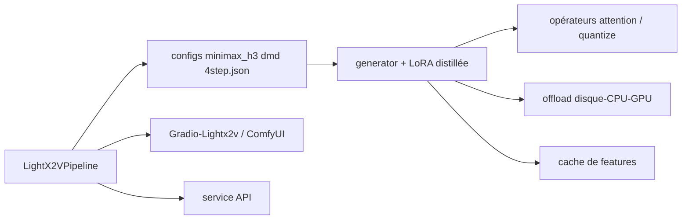

# ModelTC/LightX2V

> Lightweight inference framework for image and video generation, for those who must serve these models.

## The problem
Generating a video in 40 to 50 diffusion steps is expensive and does not fit on a consumer card.
Each model family comes with its own inference pipeline.

## What it actually does
Unified platform for T2V, I2V, T2I and image editing, behind a `LightX2VPipeline` API.
4-step distillation without CFG, `w8a8-int8`, `w8a8-fp8`, `w4a4-nvfp4` quantization,
three-level disk-CPU-GPU offloading per phase and per block, feature caching, multi-GPU
parallel inference, dynamic resolution.
Built-in operators: Sage Attention, Flash Attention, Radial Attention, q8-kernel, sgl-kernel, vllm.
Models served: MiniMax-H3, LTX-2 and 2.3, HunyuanVideo-1.5, Wan2.1/2.2, SeedVR2, SwiftVR,
Qwen-Image and its Edit variants, plus distilled LoRAs and autoregressive models.

## How it is wired


## Trying it
```bash
pip install -v git+https://github.com/ModelTC/LightX2V.git
git clone https://github.com/ModelTC/LightX2V.git && uv pip install -v .
python examples/minimax_h3/minimax_h3_t2av_dmd.py
python examples/wan/wan_i2v_nvfp4.py
```

## Cost and gotchas
Free, but it is GPU work: measurements are made on H100 and RTX 4090D, and competitors
run out of memory where LightX2V passes. The announced floor is 8 GB of VRAM and 16 GB of RAM for a
14B model at 480p/720p. Docker is the recommended route. The NVFP4 operators are compiled separately
(`lightx2v_kernel/README.md`). The Gradio interface has moved to another repository.

## What it is not
Not a model: the weights come from HuggingFace, under their own licenses.
Not an interface: Gradio, ComfyUI and the Windows deployment are separate layers.
The speed figures are the team's own measurements, on a specific configuration (Wan2.1-I2V-14B-480P,
40 steps, 81 frames).

## Alternatives
Diffusers, xDiT, FastVideo and SGL-Diffusion, compared with figures in hand; Atlas Cloud for a managed API.

## For you
Keep it if you must serve video generation on constrained hardware; otherwise, off topic.
