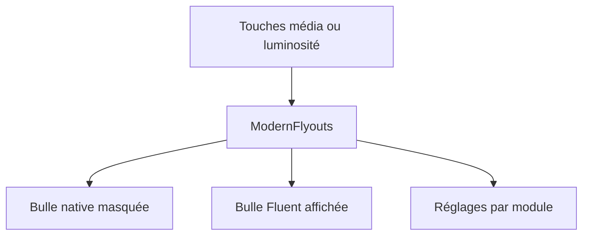

# ModernFlyouts-Community/ModernFlyouts

> Windows application that replaces the volume, brightness and airplane mode flyouts with Fluent Design versions.

## The problem
The Windows system flyouts for volume, brightness and airplane mode keep an old style, with few settings.

## What it actually does
The application temporarily hides the native flyouts and displays its own: volume and media (play, repeat, shuffle), brightness, airplane mode, lock keys. Each module can be disabled separately; position, animations, opacity, duration and display are adjustable. Windows 10 1809 or later, or Windows 11.

## How it is wired
Simplified diagram based on the sheet, no diagram provided.


## Trying it
```bash
winget install --id=ModernFlyouts.ModernFlyouts -e
```

## Cost and gotchas
Free. The repository is archived and its last push dates from November 2024; the screenshots are removed. The Chocolatey package is not maintained by the team.

## What it is not
It is not a data or AI tool. It does not handle the Fn keys or keyboard backlight, which only manufacturer drivers receive.

## Alternatives
No alternative named in the README.

## For you
Ignore: Windows cosmetics, archived, of no value for a data / AI / MLOps profile.
