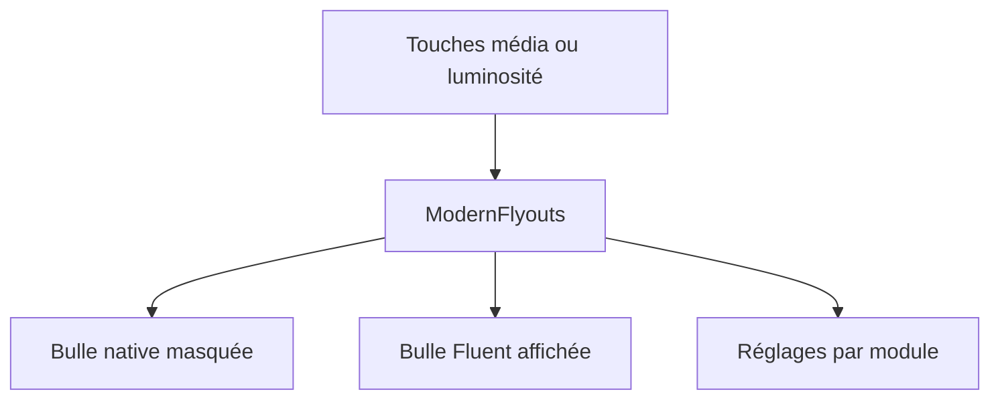

# ModernFlyouts-Community/ModernFlyouts

> Application Windows qui remplace les bulles de volume, luminosité et mode avion par des versions Fluent Design.

## Le problème
Les bulles système de Windows pour le volume, la luminosité et le mode avion gardent un style ancien, peu réglable.

## Ce que ça fait vraiment
L'application masque temporairement les bulles natives et affiche les siennes : volume et médias (lecture, répétition, aléatoire), luminosité, mode avion, touches de verrouillage. Chaque module se désactive séparément ; position, animations, opacité, durée et écran sont réglables. Windows 10 1809 ou plus récent, ou Windows 11.

## Comment c'est branché
Schéma simplifié d'après la fiche, sans diagramme fourni.


## Essayer
```bash
winget install --id=ModernFlyouts.ModernFlyouts -e
```

## Coût et pièges
Gratuit. Le dépôt est archivé et son dernier push date de novembre 2024 ; les captures d'écran sont retirées. Le paquet Chocolatey n'est pas maintenu par l'équipe.

## Ce que ce n'est pas
Ce n'est pas un outil de données ni d'IA. Il ne gère pas les touches Fn ni le rétroéclairage du clavier, que seuls les pilotes des constructeurs reçoivent.

## Alternatives
Aucune alternative nommée dans le README.

## Pour toi
À ignorer : cosmétique Windows, archivé, sans valeur pour un profil data / IA / MLOps.

