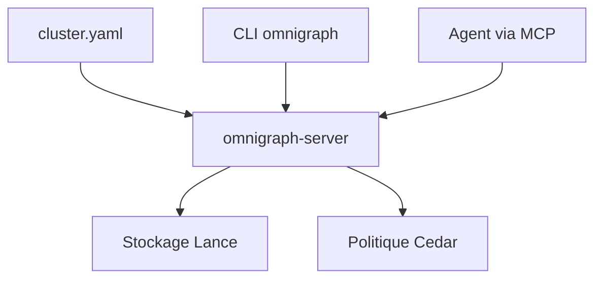

# ModernRelay/omnigraph

> A graph database on object storage, with Git branches and vector, text and graph search, for agents.

## The problem
Several agents sharing a context write to the same state with no control or history. What is missing is a typed, versioned model that can be reviewed before merging.

## What it actually does
The engine stores graphs in Lance format (local disk or S3) with a typed `.pg` schema enforced on every write. It combines vector search, BM25 and graph traversal in one query. Each agent works on a branch, with three-way merge. A Cedar policy controls every mutation on the server side.

## How it is wired
Simplified diagram based on the sheet, no diagram provided.



## Trying it
```bash
curl -fsSL https://raw.githubusercontent.com/ModernRelay/omnigraph/main/scripts/install.sh | bash
omnigraph cluster validate --config ./company-brain
omnigraph cluster plan --target production --config ./company-brain
omnigraph cluster apply --target production --config ./company-brain
omnigraph branch create --from main agent/ingest-42
omnigraph branch merge  agent/ingest-42 --into main
```

## Cost and gotchas
Free locally. Omnigraph Cloud is in private preview (waiting list). Azure is in preview and Azure writes require an admission wrapper. Building requires protobuf-compiler.

## What it is not
Not a database ready for everyone: the server is at version 0.14 and the client's HTTP contract must match the server. Nor is it an analytical warehouse.

## Alternatives
No alternative named in the README.

## For you
Worth watching: per-agent branching and hybrid search in a single engine meet a real need for agent memory, but the project is seven months old and the API contract is moving.
