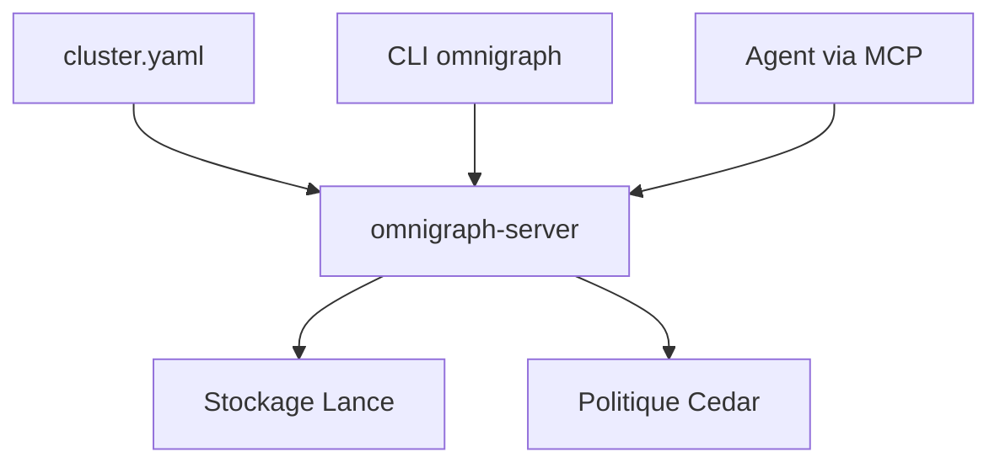

# ModernRelay/omnigraph

> Une base de graphes sur stockage objet, avec branches Git et recherche vecteur, texte et graphe, pour agents.

## Le problème
Plusieurs agents qui partagent un contexte écrivent dans le même état sans contrôle ni historique. Il manque un modèle typé, versionné et relisible avant fusion.

## Ce que ça fait vraiment
Le moteur stocke des graphes au format Lance (disque local ou S3) avec un schéma typé `.pg` appliqué à chaque écriture. Il fusionne recherche vectorielle, BM25 et parcours de graphe dans une requête. Chaque agent travaille sur une branche, fusion à trois voies. Une politique Cedar contrôle toute mutation côté serveur.

## Comment c'est branché
Schéma simplifié d'après la fiche, sans diagramme fourni.



## Essayer
```bash
curl -fsSL https://raw.githubusercontent.com/ModernRelay/omnigraph/main/scripts/install.sh | bash
omnigraph cluster validate --config ./company-brain
omnigraph cluster plan --target production --config ./company-brain
omnigraph cluster apply --target production --config ./company-brain
omnigraph branch create --from main agent/ingest-42
omnigraph branch merge  agent/ingest-42 --into main
```

## Coût et pièges
Gratuit en local. Omnigraph Cloud est en préversion privée (liste d'attente). Azure est en préversion et les écritures Azure exigent un wrapper d'admission. La compilation demande protobuf-compiler.

## Ce que ce n'est pas
Pas une base prête pour tout le monde : le serveur est en version 0.14 et le contrat HTTP du client doit correspondre au serveur. Ce n'est pas non plus un entrepôt analytique.

## Alternatives
Aucune alternative nommée dans le README.

## Pour toi
À surveiller : la branche par agent et la recherche hybride en un seul moteur répondent à un vrai besoin de mémoire d'agents, mais le projet a sept mois et le contrat d'API bouge.

