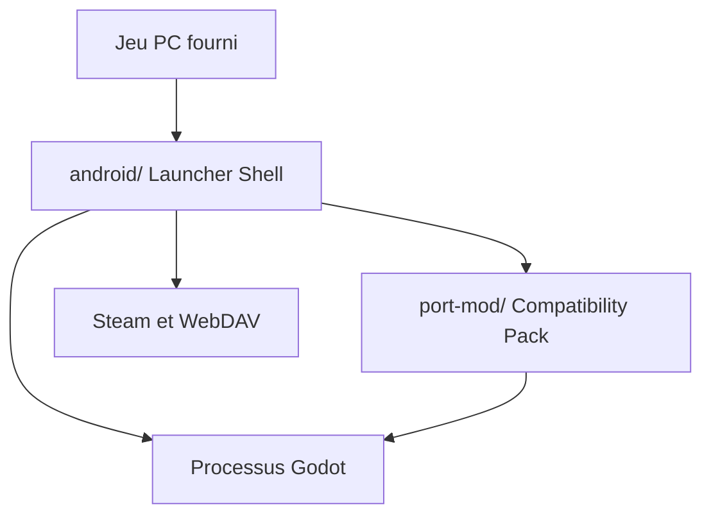

# ModinMobileSTS/Sts2MobileLauncher

> Unofficial Android launcher to run Slay the Spire 2, with mod loading and Workshop.

## The problem
The PC game has no Android version that accepts your files and your mods.

## What it actually does
- Three layers: an Android shell (import, Steam login, Workshop, saves), a Harmony compatibility pack, and the game supplied by the user.
- Syncs saves with Steam Cloud or WebDAV.
- Optional log analysis by an OpenAI-compatible LLM, with consent.
- Screen refresh rate and resolution settings, built-in keyboard.

## How it is wired


## Trying it
```bash
git clone --recursive https://github.com/ModinMobileSTS/Sts2MobileLauncher.git
cd Sts2MobileLauncher
cp .env.example .env
tools/android/sync-runtime-from-references.sh
tools/package/build_importer_apk.sh
```

## Cost and gotchas
Legal ownership of the game required. Heavy toolchain: JDK 17, Android SDK and NDK, .NET SDK, Python. The published version keeps `debuggable=true`: a computer with ADB can read the encrypted Steam credentials. Mods run arbitrary C#.

## What it is not
Not an official port nor a distribution of the game. Compatibility is not guaranteed for every version or for more than four players.

## Alternatives
No alternative named in the README.

## For you
Ignore: a mobile game launcher, unrelated to data, AI or MLOps work, with security risks for the Steam account.
