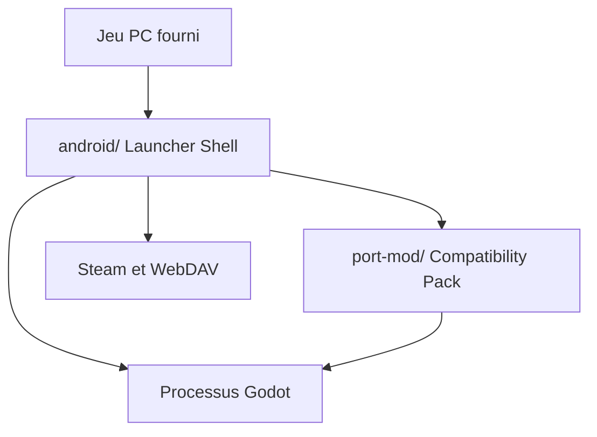

# ModinMobileSTS/Sts2MobileLauncher

> Lanceur Android non officiel pour exécuter Slay the Spire 2, avec chargement de mods et Workshop.

## Le problème
Le jeu PC n'a pas de version Android qui accepte tes fichiers et tes mods.

## Ce que ça fait vraiment
- Trois couches : une coque Android (import, connexion Steam, Workshop, sauvegardes), un pack de compatibilité Harmony et le jeu fourni par l'utilisateur.
- Synchronise les sauvegardes avec Steam Cloud ou WebDAV.
- Analyse de journaux par un LLM compatible OpenAI, facultative, avec consentement.
- Réglages de fréquence d'écran, de résolution, clavier intégré.

## Comment c'est branché


## Essayer
```bash
git clone --recursive https://github.com/ModinMobileSTS/Sts2MobileLauncher.git
cd Sts2MobileLauncher
cp .env.example .env
tools/android/sync-runtime-from-references.sh
tools/package/build_importer_apk.sh
```

## Coût et pièges
Possession légale du jeu requise. Chaîne lourde : JDK 17, SDK et NDK Android, .NET SDK, Python. La version publiée garde `debuggable=true` : un ordinateur avec ADB peut lire les identifiants Steam chiffrés. Les mods exécutent du C# arbitraire.

## Ce que ce n'est pas
Pas un portage officiel ni une distribution du jeu. La compatibilité n'est pas garantie pour chaque version ni pour plus de quatre joueurs.

## Alternatives
Aucune alternative nommée dans le README.

## Pour toi
À ignorer : un lanceur de jeu mobile, sans rapport avec un travail data, IA ou MLOps, avec des risques de sécurité sur le compte Steam.

