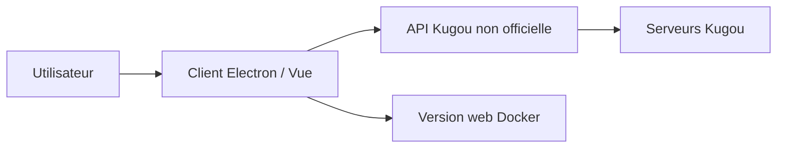

# MoeKoeMusic/MoeKoeMusic

> Unofficial Electron/Vue music client for the Chinese Kugou service, for its users.

## The problem
The official Kugou client on Mac is limited and unstable, according to the author.

## What it actually does
Replaces the Kugou interface: login by QR code or account, lyrics, daily recommendations, MV videos, themes, global shortcuts, a plugin system. Available as a desktop client (Windows, macOS, Linux) and as a web version via Docker. The API comes from MakcRe/KuGouMusicApi. The README claims automatic VIP on login.

## How it is wired


## Trying it
```bash
git clone --depth=1 https://github.com/MoeKoeMusic/MoeKoeMusic.git
cd MoeKoeMusic
docker compose up -d &
# ou en développement : npm install && npm run dev
```

## Cost and gotchas
Free, but you need a Kugou account. The mentions of free VIP and of circumvention carry a legal risk and a risk of account blocking. The README is in Chinese.

## What it is not
Not an official client. A repository "for learning purposes": commercial use is forbidden and there is a clause to delete data within 24 h.

## Alternatives
- YesPlayMusic: cited as a source of inspiration, for other music services.

## For you
Ignore: a Chinese music service unrelated to data or AI, and a risk of rights circumvention.
