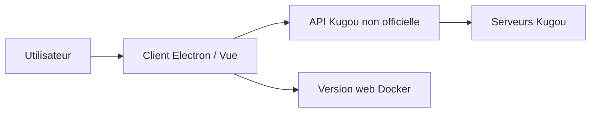

# MoeKoeMusic/MoeKoeMusic

> Client musical Electron/Vue non officiel pour le service chinois Kugou, pour ses utilisateurs.

## Le problème
Le client officiel Kugou sur Mac est limité et instable, selon l'auteur.

## Ce que ça fait vraiment
Remplace l'interface Kugou : connexion par QR code ou compte, paroles, recommandations du jour, vidéos MV, thèmes, raccourcis globaux, système de plugins. Existe en client de bureau (Windows, macOS, Linux) et en version web via Docker. L'API provient de MakcRe/KuGouMusicApi. Le README affirme un VIP automatique à la connexion.

## Comment c'est branché


## Essayer
```bash
git clone --depth=1 https://github.com/MoeKoeMusic/MoeKoeMusic.git
cd MoeKoeMusic
docker compose up -d &
# ou en développement : npm install && npm run dev
```

## Coût et pièges
Gratuit, mais il faut un compte Kugou. Les mentions de VIP gratuit et de contournement posent un risque juridique et de blocage de compte. Le README est en chinois.

## Ce que ce n'est pas
Pas un client officiel. Dépôt « pour apprentissage » : usage commercial interdit et clause de suppression des données sous 24 h.

## Alternatives
- YesPlayMusic : cité comme source d'inspiration, pour d'autres services musicaux.

## Pour toi
À ignorer : service musical chinois sans lien avec la data ou l'IA, et risque de contournement de droits.

