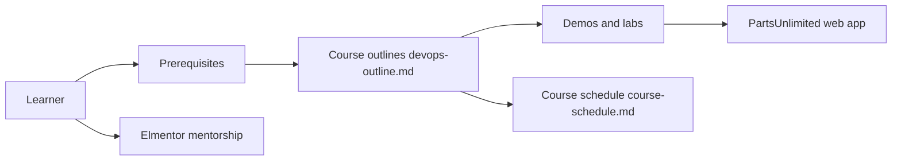

# MohamedRadwan-DevOps/devops-step-by-step

> Online DevOps course path, from IT fundamentals to Azure DevOps and Terraform, with associated mentoring.

## The problem
Beginners look for a structured progression toward DevOps rather than a pile of scattered tutorials.

## What it actually does
The repository organizes four tracks: introduction to IT, software engineering and DevOps fundamentals, Microsoft DevOps (certification preparation) and Terraform. Each track links to outlines, objectives, demos and FAQs. It also presents an external mentoring program (Elmentor) and contribution guides. The visible sample code is a PartsUnlimited web application, with no stated link to a course.

## How it is wired


## Trying it
No commands: the README documents none. You just browse the course folders.
```bash
# non documenté : aucune commande dans le README
```

## Cost and gotchas
Free to read. Mentoring goes through a separate platform whose terms are not in the README. No license declared: reuse of the content is not guaranteed.

## What it is not
Not a tool, nor a course for data / AI: the content is general-purpose DevOps and Azure. Nothing indicates that the labs are tested.

## Alternatives
No alternative named in the README.

## For you
Ignore: little relevance to your data/AI/MLOps profile (a general course centered on Azure and Terraform), and the missing license limits reuse.
