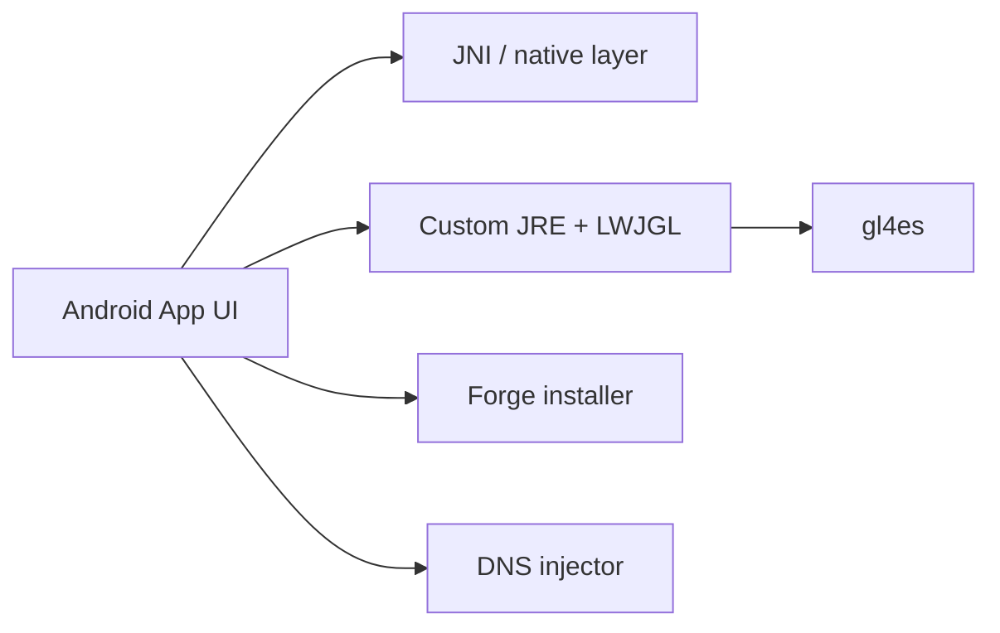

# MojoLauncher/MojoLauncher

> Android launcher for playing Minecraft Java Edition, derived from PojavLauncher.

## The problem
Minecraft Java does not run natively on Android; you need a launcher that bundles a JRE and the graphics layer.

## What it actually does
Android application (module `app_pojavlauncher`) with custom multi-architecture JREs, LWJGL/GLFW integration, a native JNI layer (OpenGL/Vulkan graphics, input), gl4es, a DNS agent, and a Forge installer. It runs almost every version and the Forge/Fabric modloaders. Available as a release, on Google Play, as Actions builds, or by compiling it yourself.

## How it is wired


## Trying it
```bash
./gradlew :app_mojo:assembleDebug
```

## Cost and gotchas
Free, but you must own Minecraft (not stated in the README). On Windows, symbolic links must be created for `mojoexec`, `sdl`, `glfw`. Known issues: sluggish mouse, distorted textures with gl4es. LGPL-3.0.

## What it is not
Not a development or data tool: it is a game launcher.

## Alternatives
- PojavLauncher: the original project, as cited.

## For you
Ignore: no relevance to a data/AI/MLOps profile.
