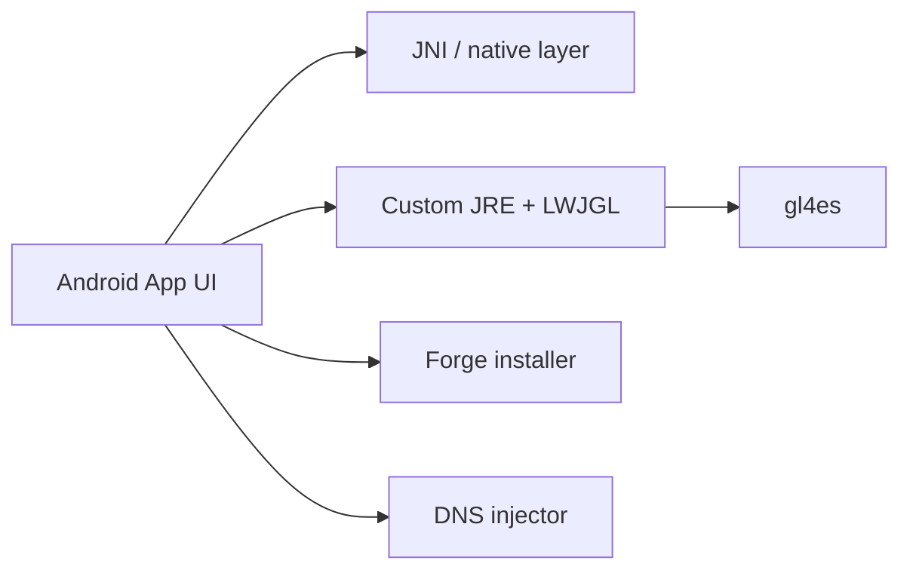

# MojoLauncher/MojoLauncher

> Lanceur Android pour jouer à Minecraft Java Edition, dérivé de PojavLauncher.

## Le problème
Minecraft Java ne tourne pas nativement sur Android ; il faut un lanceur qui embarque un JRE et la couche graphique.

## Ce que ça fait vraiment
Application Android (module `app_pojavlauncher`) avec JRE personnalisés multi-architectures, intégration LWJGL/GLFW, couche native JNI (graphismes OpenGL/Vulkan, entrées), gl4es, agent DNS, installeur Forge. Lance presque toutes les versions et les modloaders Forge/Fabric. Disponible en release, Google Play, builds Actions ou compilation.

## Comment c'est branché


## Essayer
```bash
./gradlew :app_mojo:assembleDebug
```

## Coût et pièges
Gratuit, mais Minecraft doit être possédé (non précisé dans le README). Sous Windows, liens symboliques à créer pour `mojoexec`, `sdl`, `glfw`. Problèmes connus : souris lente, textures déformées avec gl4es. LGPL-3.0.

## Ce que ce n'est pas
Pas un outil de développement ni de données : un lanceur de jeu.

## Alternatives
- PojavLauncher : projet d'origine cité.

## Pour toi
À ignorer : aucun rapport avec un profil data/IA/MLOps.

