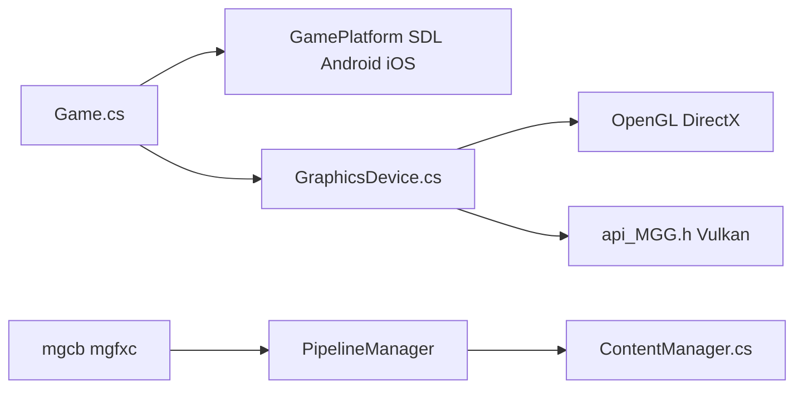

# MonoGame/MonoGame

> Open-source cross-platform .NET video game framework, a reimplementation of Microsoft's XNA.

## The problem
Writing a portable game in C# for PC, consoles and mobile without a proprietary engine.

## What it actually does
`Game` lifecycle, managed graphics API (`GraphicsDevice`, `SpriteBatch`), platform hosts (SDL, Android, iOS), OpenGL, DirectX and native Vulkan backends via P/Invoke. Content pipeline: `mgcb` (CLI), graphical editor, `mgfxc` effects compiler.

## How it is wired


## Trying it
```bash
git clone --recurse-submodules https://github.com/MonoGame/MonoGame.git
git submodule update --init
```

## Cost and gotchas
Free (supported by subscription). Built from source with submodules; license not identified by GitHub.

## What it is not
Not an engine with a scene editor: a framework of code and content tools.

## Alternatives
No alternative named in the README.

## For you
Ignore: video games are outside your data/AI scope.
