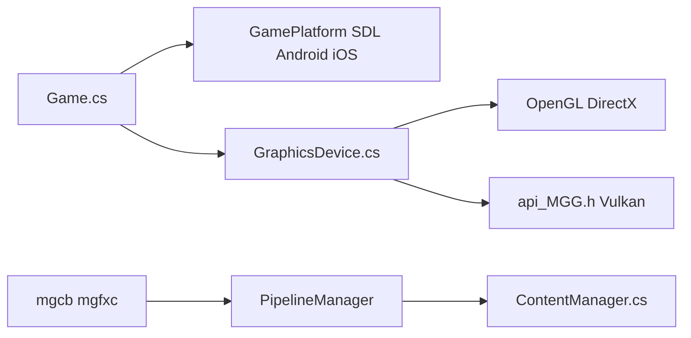

# MonoGame/MonoGame

> Framework .NET open source de jeu vidéo multiplateforme, ré-implémentation du XNA de Microsoft.

## Le problème
Écrire en C# un jeu portable sur PC, consoles et mobiles sans moteur propriétaire.

## Ce que ça fait vraiment
Cycle de vie `Game`, API graphique gérée (`GraphicsDevice`, `SpriteBatch`), hôtes de plateforme (SDL, Android, iOS), backends OpenGL, DirectX et Vulkan natif via P/Invoke. Chaîne de contenu : `mgcb` (CLI), éditeur graphique, compilateur d'effets `mgfxc`.

## Comment c'est branché


## Essayer
```bash
git clone --recurse-submodules https://github.com/MonoGame/MonoGame.git
git submodule update --init
```

## Coût et pièges
Gratuit (soutien par abonnement). Compilation depuis les sources avec sous-modules ; licence non identifiée par GitHub.

## Ce que ce n'est pas
Pas un moteur avec éditeur de scènes : un framework de code et d'outils de contenu.

## Alternatives
Aucune alternative nommée dans le README.

## Pour toi
Ignorer : le jeu vidéo est hors de ton périmètre data/IA.

