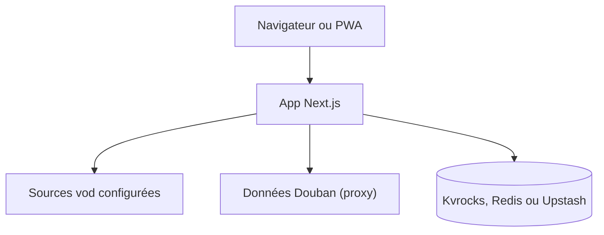

# MoonTechLab/LunaTV

> Self-hosted movie and series aggregator: multi-source search, online playback, synced favorites.

## The problem
Searching and following videos across several sites without a single interface or shared history.

## What it actually does
Next.js 14 application: aggregated search, detail pages, HLS playback (ArtPlayer), favorites and playback resume stored in Kvrocks, Redis or Upstash, PWA, experimental ad skipping. The deployment is an empty shell: playback sources must be supplied through a configuration file (Apple CMS V10-type API).

## How it is wired


## Trying it
```bash
# docker compose avec l'image ghcr.io/moontechlab/lunatv:latest
# variables : USERNAME, PASSWORD, NEXT_PUBLIC_STORAGE_TYPE, KVROCKS_URL
```

## Cost and gotchas
Free, but it needs Kvrocks, Redis or Upstash storage and playback sources you must find yourself. Docker deployment only. The README asks you to close public registrations and not to share the instance.

## What it is not
Hosts no content and provides no source. The README disclaims all legal responsibility; license present but unidentified. README in Chinese.

## Alternatives
- LibreTV: the project this one is inspired by.
- Selene and OrionTV: compatible mobile and Android TV clients.

## For you
Ignore: unrelated to data or AI, and a legal gray area tied to content sources.
