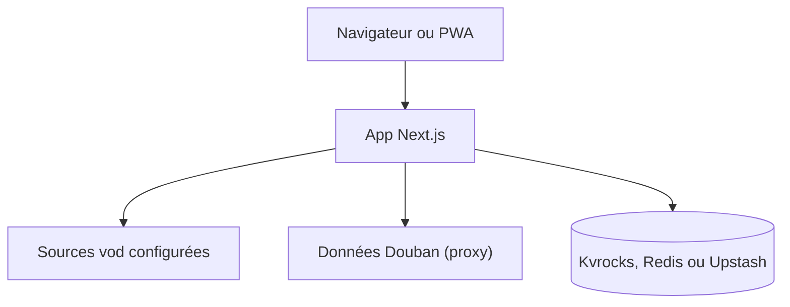

# MoonTechLab/LunaTV

> Agrégateur de films et séries auto-hébergé : recherche multi-sources, lecture en ligne, favoris synchronisés.

## Le problème
Chercher et suivre des vidéos sur plusieurs sites sans interface unique ni historique partagé.

## Ce que ça fait vraiment
Application Next.js 14 : recherche agrégée, fiches détaillées, lecture HLS (ArtPlayer), favoris et reprise de lecture stockés dans Kvrocks, Redis ou Upstash, PWA, saut de publicités expérimental. Le déploiement est une coquille vide : sources de lecture à fournir via un fichier de configuration (API de type Apple CMS V10).

## Comment c'est branché


## Essayer
```bash
# docker compose avec l'image ghcr.io/moontechlab/lunatv:latest
# variables : USERNAME, PASSWORD, NEXT_PUBLIC_STORAGE_TYPE, KVROCKS_URL
```

## Coût et pièges
Gratuit, mais il faut un stockage Kvrocks, Redis ou Upstash et des sources de lecture à trouver soi-même. Déploiement Docker uniquement. Le README demande de fermer les inscriptions publiques et de ne pas partager l'instance.

## Ce que ce n'est pas
N'héberge aucun contenu et ne fournit aucune source. Le README décline toute responsabilité juridique ; licence présente mais non identifiée. README en chinois.

## Alternatives
- LibreTV : projet dont celui-ci s'inspire.
- Selene et OrionTV : clients mobile et Android TV compatibles.

## Pour toi
Ignorer : sans rapport avec la data ou l'IA, et zone juridique grise liée aux sources de contenu.

