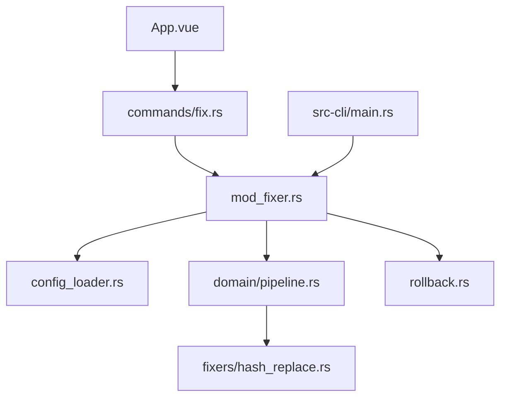

# Moonholder/Wuwa_Mod_Fixer

> Tool that repairs Wuthering Waves game mods broken by an update, with a GUI or on the command line.

## The problem
Every game update changes resource hashes and breaks mods.

## What it actually does
Finds the changed hashes and replaces them, with a prior backup and rollback. Available as a graphical version (Tauri, Vue) and a command-line version, on Windows and Linux, with fix options and JSON output. According to the code, the interface and the CLI binary both call `mod_fixer.rs`, which loads `config.json` and runs a pipeline of fixers.

## How it is wired


## Trying it
```bash
./wuwa-mod-cli --path "D:\Mods\MyMod"
./wuwa-mod-cli --path "D:\Mods\MyMod" --rollback
npm run tauri dev
```

## Cost and gotchas
Free. The `--online` option fetches the configuration remotely. Building requires Rust and Node 20 or later. GPL-3.0 license.

## What it is not
Not an attack tool: it fixes local mod files. README in Chinese.

## Alternatives
No alternative named in the README.

## For you
Ignore: video game utility unrelated to your field.
