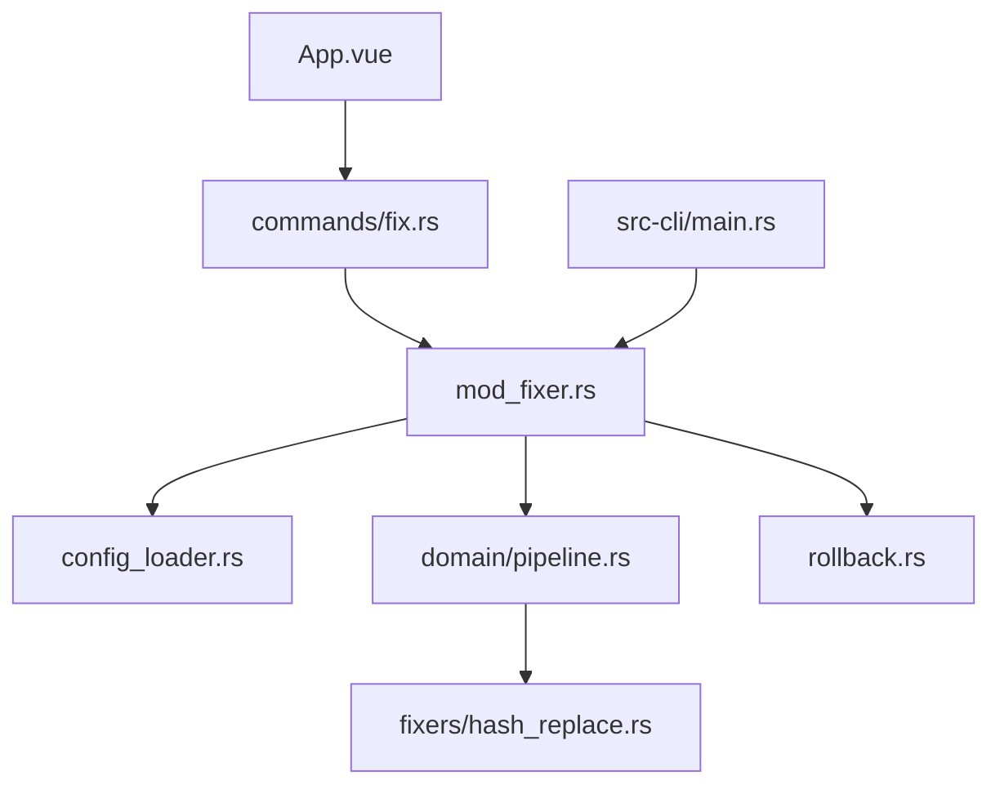

# Moonholder/Wuwa_Mod_Fixer

> Outil qui répare les mods du jeu Wuthering Waves cassés par une mise à jour, en interface ou en ligne de commande.

## Le problème
Chaque mise à jour du jeu change les hachages de ressources et casse les mods.

## Ce que ça fait vraiment
Repère les hachages modifiés et les remplace, avec sauvegarde préalable et retour arrière. Existe en version graphique (Tauri, Vue) et en ligne de commande, sous Windows et Linux, avec options de correction et sortie JSON. D'après le code, l'interface et le binaire CLI appellent `mod_fixer.rs`, qui charge `config.json` et enchaîne un pipeline de correcteurs.

## Comment c'est branché


## Essayer
```bash
./wuwa-mod-cli --path "D:\Mods\MyMod"
./wuwa-mod-cli --path "D:\Mods\MyMod" --rollback
npm run tauri dev
```

## Coût et pièges
Gratuit. L'option `--online` récupère la configuration à distance. La compilation demande Rust et Node 20 ou plus. Licence GPL-3.0.

## Ce que ce n'est pas
Pas un outil d'attaque : il corrige des fichiers de mods locaux. README en chinois.

## Alternatives
Aucune alternative nommée dans le README.

## Pour toi
À ignorer : utilitaire de jeu vidéo sans rapport avec ton métier.

