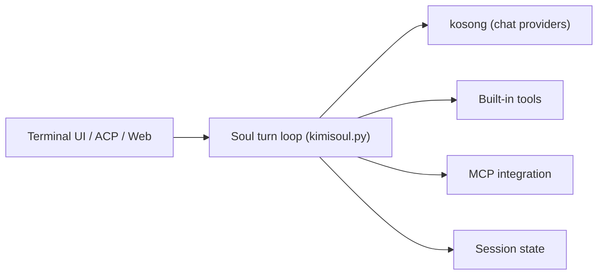

# MoonshotAI/kimi-cli

> Terminal AI agent that reads and edits code and runs commands, being wound down.

## The problem
Development and operations tasks require juggling between editor, shell and web search.

## What it actually does
An agent whose loop ("soul") assembles the context, calls local tools (files, shell, web) and a model. It runs in a terminal, as an ACP server for Zed/JetBrains, or as a web interface. Supports MCP, plugins, skills and sub-agents. The README announces that it is evolving into Kimi Code CLI and will be gradually shut down.

## How it is wired


## Trying it
```bash
kimi mcp add --transport http context7 https://mcp.context7.com/mcp --header "CONTEXT7_API_KEY: ctx7sk-your-key"
kimi mcp list
kimi --mcp-config-file /path/to/mcp.json
```
Installation commands are not given in this README.

## Cost and gotchas
A login (`/login`) or an API key is required; the cost is not specified. The project has an announced end of life.

## What it is not
Not a project meant to last: the README announces a gradual shutdown in favor of Kimi Code CLI. Built-in shell commands such as `cd` are not handled in shell mode.

## Alternatives
Kimi Code CLI, the announced successor; other agents are not named.

## For you
Watch the successor rather than this one: the project is being shut down, so it is a poor investment for a lasting tool.
