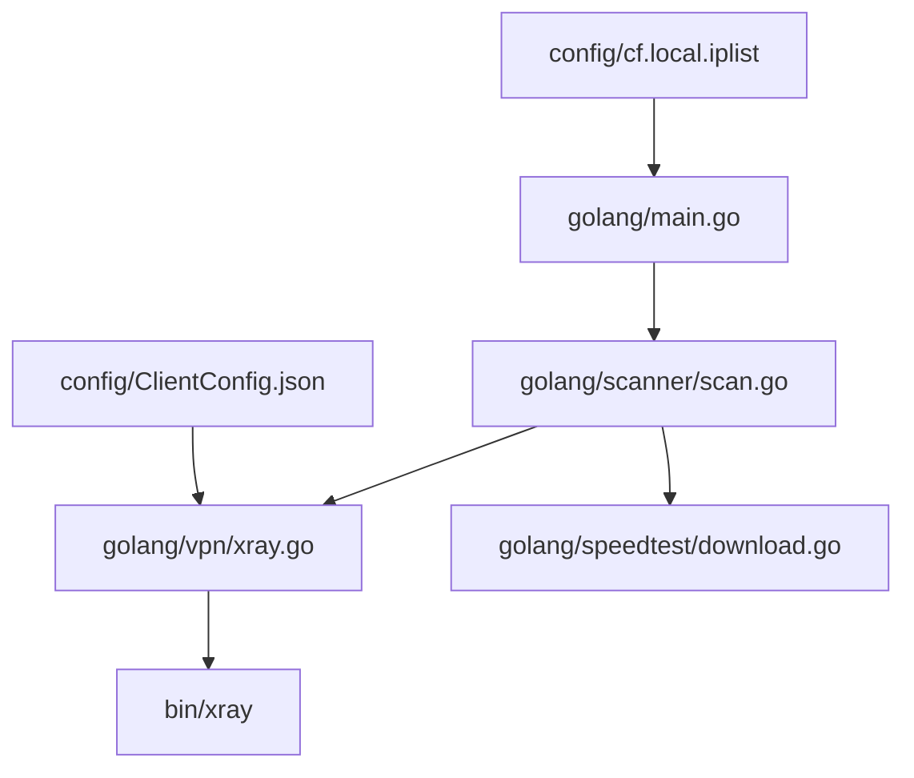

# MortezaBashsiz/CFScanner

> Cloudflare IP address scanner that finds the ones that go through the CDN, for v2ray proxy users.

## The problem
Finding by hand which Cloudflare IP addresses are actually usable with a v2ray tunnel is slow: there are millions of them.

## What it actually does
The script reads a list of Cloudflare addresses, launches an xray client with the supplied configuration (vmess, websocket, TLS by default), then measures upload and download throughput. It writes a file of the addresses that work. The same scanner exists in Bash, Go, Python, C# (Windows) and Android.

## How it is wired
Diagram based on the code's diagram, simplified.

## Trying it
No command is documented in the README: it points to per-language subfolders (Bash, Docker, Windows, Python, Golang, Android).

## Cost and gotchas
Free, but you need a vmess account to use it behind your own Cloudflare proxy. Scanning millions of addresses consumes bandwidth.

## What it is not
Not a ready-to-use VPN: it is an address-sorting tool for an already existing setup. The README is thin (crypto donations, videos).

## Alternatives
No alternative named in the README.

## For you
Ignore for a data / AI / MLOps profile: a network circumvention use unrelated to your field.
