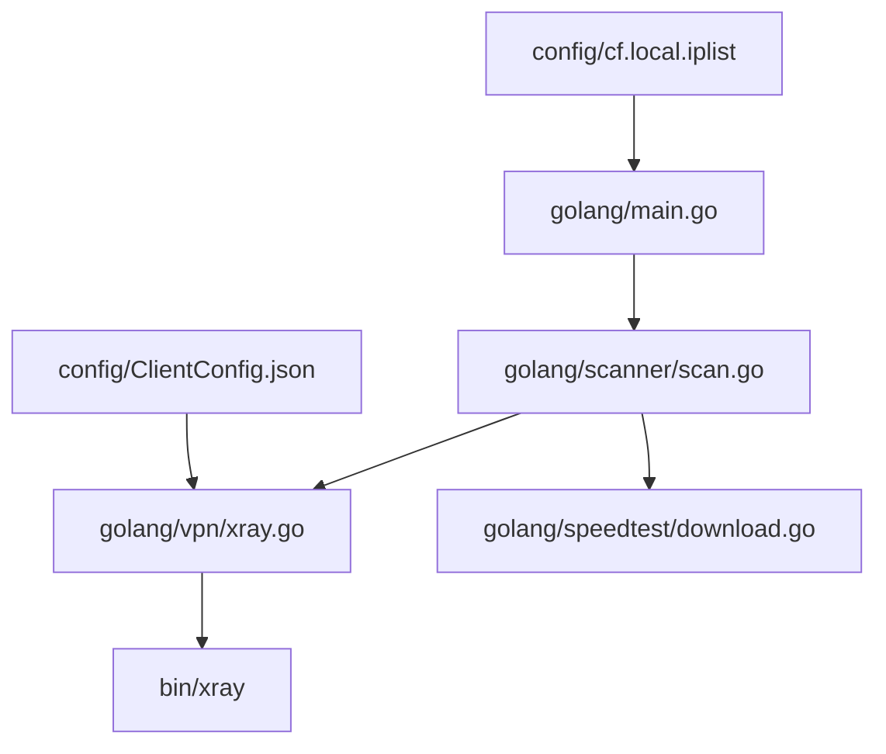

# MortezaBashsiz/CFScanner

> Scanner d'adresses IP Cloudflare qui repère celles qui passent par le CDN, pour utilisateurs de proxys v2ray.

## Le problème
Trouver à la main quelles adresses IP Cloudflare sont réellement utilisables avec un tunnel v2ray est long : il y en a des millions.

## Ce que ça fait vraiment
Le script lit une liste d'adresses Cloudflare, lance un client xray avec la configuration fournie (vmess, websocket, TLS par défaut) puis mesure débit montant et descendant. Il écrit un fichier des adresses qui fonctionnent. Le même scanner existe en Bash, Go, Python, C# (Windows) et Android.

## Comment c'est branché
Schéma d'après le diagramme du code, simplifié.

## Essayer
Aucune commande n'est documentée dans le README : il renvoie vers des sous-dossiers par langage (Bash, Docker, Windows, Python, Golang, Android).

## Coût et pièges
Gratuit, mais il faut un compte vmess pour l'usage derrière son propre proxy Cloudflare. Le scan de millions d'adresses consomme de la bande passante.

## Ce que ce n'est pas
Ce n'est pas un VPN prêt à l'emploi : c'est un outil de tri d'adresses pour un montage déjà existant. Le README est maigre (dons en crypto, vidéos).

## Alternatives
Aucune alternative nommée dans le README.

## Pour toi
À ignorer pour un profil data / IA / MLOps : usage de contournement réseau sans lien avec ton métier.

