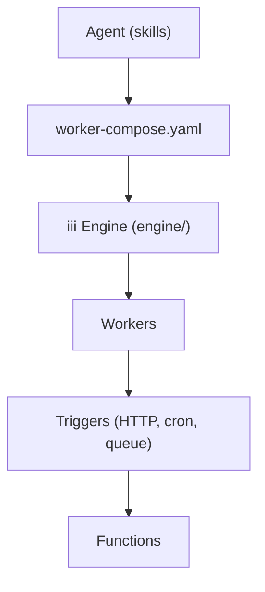

# MotiaDev/motia

> "iii" engine that composes queues, cron, HTTP, state and agents into workers observable in real time.

## The problem
Every building block of a backend (queue, cron, agent, observability) comes with its own integration, its own retry settings and its own separate traces.

## What it actually does
The engine (Rust) exposes three primitives: workers, triggers and functions. A worker registers, declares its functions and their triggers, and other workers can call it right away. Workers are declared in `worker-compose.yaml` or added live, including by an agent. SDKs exist for Node, Python, Rust and Go.

## How it is wired

The provided diagram describes the old Motia project (snap, workbench) and no longer matches the README: diagram drawn from the README.

## Trying it
```bash
curl -fsSL https://install.iii.dev/iii/main/install.sh | sh
iii compose --namespace dev --up
iii trigger -n dev compose::add worker=queue
```

## Cost and gotchas
Free. Installation goes through a `curl | sh` script. The project changed its name and content: the old documentation and diagram are misleading.

## What it is not
Not the Motia framework described by the old diagram. Not a managed platform: you run the engine yourself.

## Alternatives
No alternative named in the README.

## For you
Worth watching: an appealing idea of a catalog of functions callable by agents, but undeclared license, recent renaming and unknown maturity.
