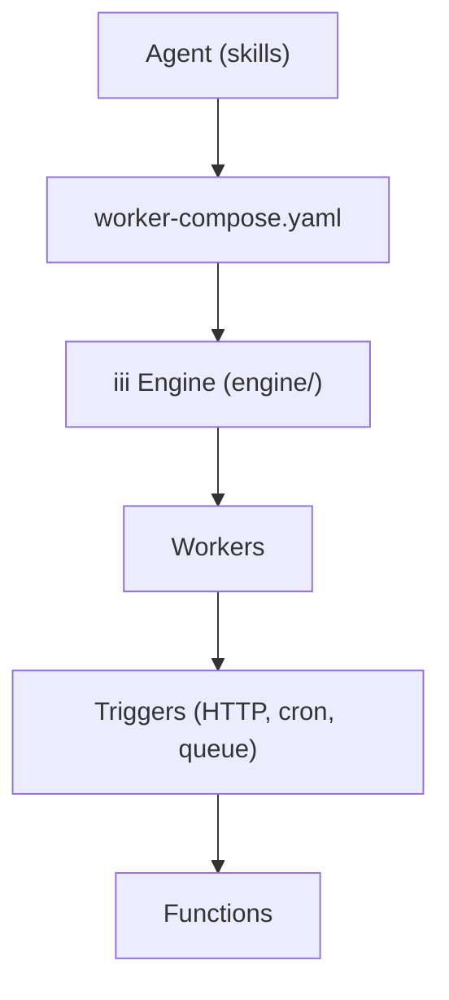

# MotiaDev/motia

> Moteur « iii » qui compose files, cron, HTTP, état et agents en workers observables en temps réel.

## Le problème
Chaque brique d'un backend (queue, cron, agent, observabilité) arrive avec son intégration, ses réglages de reprise et ses traces séparés.

## Ce que ça fait vraiment
Le moteur (Rust) expose trois primitives : workers, triggers et fonctions. Un worker s'enregistre, déclare ses fonctions et leurs déclencheurs, et les autres workers peuvent l'appeler tout de suite. Les workers se déclarent dans `worker-compose.yaml` ou s'ajoutent à chaud, y compris par un agent. Des SDK existent pour Node, Python, Rust et Go.

## Comment c'est branché

Le diagramme fourni décrit l'ancien projet Motia (snap, workbench) et ne correspond plus au README : schéma tiré du README.

## Essayer
```bash
curl -fsSL https://install.iii.dev/iii/main/install.sh | sh
iii compose --namespace dev --up
iii trigger -n dev compose::add worker=queue
```

## Coût et pièges
Gratuit. L'installation passe par un script `curl | sh`. Le projet a changé de nom et de contenu : la documentation et le diagramme anciens induisent en erreur.

## Ce que ce n'est pas
Pas le framework Motia décrit par l'ancien diagramme. Pas une plateforme managée : tu fais tourner le moteur toi-même.

## Alternatives
Aucune alternative nommée dans le README.

## Pour toi
À surveiller : idée séduisante d'un catalogue de fonctions appelables par des agents, mais licence non déclarée, renommage récent et maturité inconnue.

