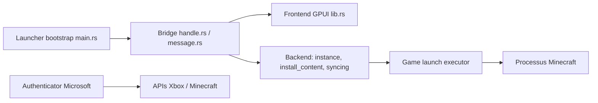

# Moulberry/PandoraLauncher

> Native Minecraft launcher in Rust: instances, Modrinth and CurseForge mods, synchronization between instances.

## The problem
Managing several Minecraft instances with duplicated mods, accounts and settings to resynchronize by hand.

## What it actually does
Native interface (GPUI) that creates and launches instances, browses Modrinth and CurseForge, deduplicates mods through hard links or reflinks, synchronizes options and saves, imports from ATLauncher, CurseForge, Modrinth and MultiMC. Credentials go into the system keyring; an optional sandbox exists.

## How it is wired


## Trying it
```bash
# Aucune commande dans le README : voir les issues GitHub pour retours et bugs.
```

## Cost and gotchas
Free, with no monetization planned according to the author. You need a Microsoft account with Minecraft to launch the game. The README shows "Work in progress".

## What it is not
Not a work tool: a game launcher. The README documents neither installation nor build; the architecture above comes from the code.

## Alternatives
No alternative cited in the README.

## For you
Ignore: game launcher unrelated to data, AI or MLOps work.
