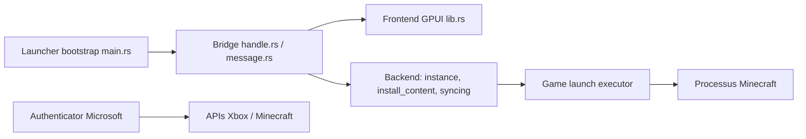

# Moulberry/PandoraLauncher

> Lanceur Minecraft natif en Rust : instances, mods Modrinth et CurseForge, synchronisation entre instances.

## Le problème
Gérer plusieurs instances Minecraft avec des mods dupliqués, des comptes et des réglages à resynchroniser à la main.

## Ce que ça fait vraiment
Interface native (GPUI) qui crée et lance des instances, parcourt Modrinth et CurseForge, déduplique les mods par liens physiques ou reflinks, synchronise options et sauvegardes, importe depuis ATLauncher, CurseForge, Modrinth et MultiMC. Les identifiants vont dans le trousseau du système ; un sandbox optionnel existe.

## Comment c'est branché


## Essayer
```bash
# Aucune commande dans le README : voir les issues GitHub pour retours et bugs.
```

## Coût et pièges
Gratuit, sans monétisation prévue selon l'auteur. Il faut un compte Microsoft avec Minecraft pour lancer le jeu. Le README affiche « Work in progress ».

## Ce que ce n'est pas
Pas un outil de travail : un lanceur de jeu. Le README ne documente ni installation ni build ; l'architecture ci-dessus vient du code.

## Alternatives
Aucune alternative citée dans le README.

## Pour toi
Ignorer : lanceur de jeu sans rapport avec un travail data, IA ou MLOps.

