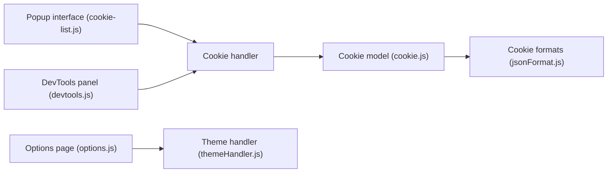

# Moustachauve/cookie-editor

> Browser extension to create, edit and delete the cookies of the current tab.

## The problem
Inspecting and editing a page's cookies to develop, test or manage privacy is poorly served by the built-in tools.

## What it actually does
- Creation, editing, deletion, bulk deletion of the visited site's cookies.
- Export in several formats (JSON, header, Netscape).
- Popup panel, DevTools, side panel, mobile interface.
- Chrome, Firefox, Safari, Edge, Opera.

## How it is wired


## Trying it
```bash
npm install
grunt
```
Files are output to `dist`. Safari is built in Xcode.

## Cost and gotchas
Free; the graph mentions an ad selector (adHandler.js), not detailed in the README. Cookie read permissions must be granted.

## What it is not
Not a password manager; only touches the current site.

## Alternatives
No alternative named in the README.

## For you
Worth watching: handy for debugging dashboard or web API sessions, otherwise an accessory.
