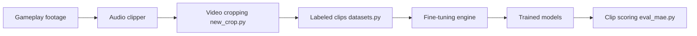

# Mr-Homeless/waldo

> Local application that scores the probability of cheating on Counter-Strike 2 video clips, with a model you train yourself.

## The problem
Spotting aimbot cheating in gameplay videos requires manually reviewing hundreds of sequences.

## What it actually does
Local Flask web application: detects frags from the audio, extracts 2-second clips, lets you label them "cheater" or not, trains or fine-tunes a VideoMAE v2 model (a one-billion-parameter vision transformer), then scores clips from 0 to 1 with a visualization of the 16 frames analyzed and a JSON export. Local processing, no data sent out.

## How it is wired


## Trying it
```bash
git clone https://github.com/Mr-Homeless/waldo.git
cd waldo
chmod +x install.sh
./install.sh
./run.sh
# puis ouvrir http://localhost:5000
```

## Cost and gotchas
NVIDIA GPU with CUDA, 16 to 32 GB of RAM, about 10 GB of disk, a 1.9 GB checkpoint from HuggingFace. The Linux script is flagged as untested. The author's more accurate models are offered on Patreon.

## What it is not
Not a ready-to-use detector: it requires a model trained on your own labeled clips (at least 48). A score is not proof of cheating, and accusing a player on this basis would be risky. Limited to CS2.

## Alternatives
No alternative named in the README.

## For you
Ignore: little demonstrated reliability (alpha, no published metrics, data to label yourself), and no license; only the VideoMAE fine-tuning example may be instructive.
