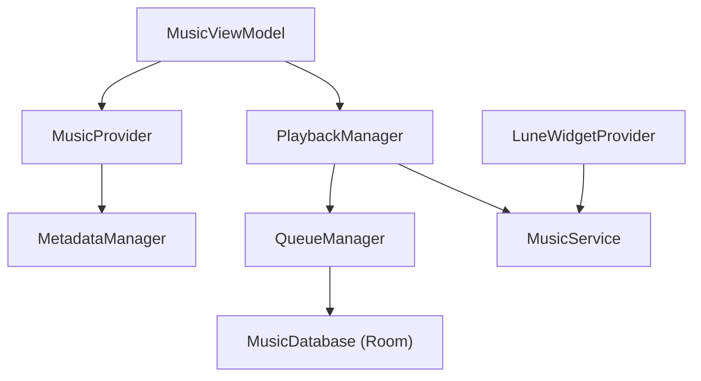

# MrDemonc/Lune

> Offline Android music player in Jetpack Compose, with no Internet permission, for those who want customizable sound.

## The problem
Android music players often bundle ads, tracking or an account. This one plays only local files, with no network.

## What it actually does
- Playback of local files (MP3, FLAC, Opus, etc.) with persistent queue and playlists.
- 10-band equalizer, reverb, dynamic compression, balance, pitch and speed.
- Synchronized lyrics, visualizer, 12-second crossfade, timer.
- Home screen widget with advanced blur; available on F-Droid.

## How it is wired


## Trying it
```bash
git clone https://github.com/MrDemonc/Lune.git
cd Lune
./gradlew assembleRelease
```
Otherwise, install from F-Droid (link in the README).

## Cost and gotchas
Free. To build: JDK 17 or later, Android SDK 37, Gradle (wrapper provided) and a `keystore.properties` file for signing. Monero donations offered.

## What it is not
Not a streaming service: it only plays local storage. GPL-3.0 license, restrictive for derivatives.

## Alternatives
No alternative cited in the README.

## For you
Ignore: consumer Android application, unrelated to your data / AI work.
