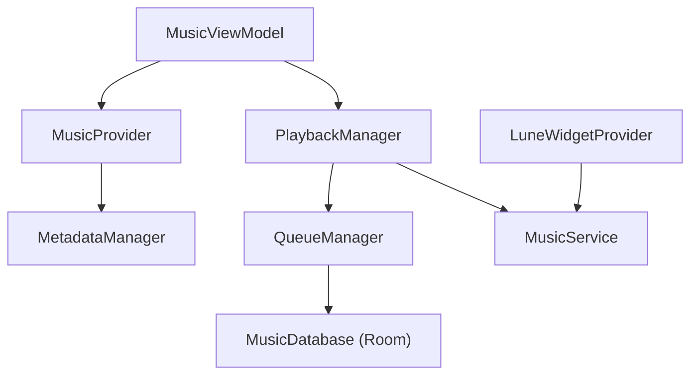

# MrDemonc/Lune

> Lecteur de musique Android hors ligne en Jetpack Compose, sans permission Internet, pour qui veut un son personnalisable.

## Le problème
Les lecteurs musicaux Android embarquent souvent publicité, pistage ou compte. Celui-ci joue uniquement les fichiers locaux, sans réseau.

## Ce que ça fait vraiment
- Lecture de fichiers locaux (MP3, FLAC, Opus, etc.) avec file d'attente persistante et playlists.
- Égaliseur 10 bandes, réverbération, compression dynamique, balance, hauteur et vitesse.
- Paroles synchronisées, visualiseur, fondu enchaîné de 12 secondes, minuteur.
- Widget d'écran d'accueil au flou avancé ; disponible sur F-Droid.

## Comment c'est branché


## Essayer
```bash
git clone https://github.com/MrDemonc/Lune.git
cd Lune
./gradlew assembleRelease
```
Sinon, installer depuis F-Droid (lien du README).

## Coût et pièges
Gratuit. Pour compiler : JDK 17 ou plus, Android SDK 37, Gradle (wrapper fourni) et un fichier `keystore.properties` pour signer. Dons en Monero proposés.

## Ce que ce n'est pas
Pas un service de streaming : il ne lit que le stockage local. Licence GPL-3.0, contraignante pour les dérivés.

## Alternatives
Aucune alternative citée dans le README.

## Pour toi
À ignorer : application Android grand public, sans rapport avec ton travail data / IA.

