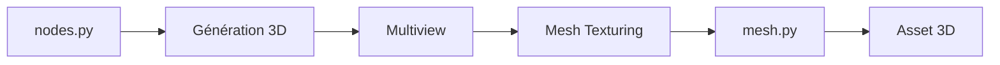

# MrForExample/ComfyUI-3D-Pack

> A suite of ComfyUI nodes to generate and process 3D assets (mesh, texture, 3DGS) from images.

## The problem
Recent 3D generation models each have their own repository and pipeline; chaining them requires ad hoc code.

## What it actually does
Exposes image-to-3D models in ComfyUI (Hunyuan3D, TRELLIS, TripoSG, InstantMesh, Wonder3D, PartCrafter…), multiview, texturing, 3D Gaussian Splatting and orbital renders. Exports .obj, .ply, .glb. The architecture that was read does not confirm the wiring of every branch.

## How it is wired


## Trying it
```bash
cd Your ComfyUI Root Directory\ComfyUI\custom_nodes\
git clone https://github.com/MrForExample/ComfyUI-3D-Pack.git
cd ComfyUI-3D-Pack
Your ComfyUI Root Directory\python_embeded\python.exe -s -m pip install -r requirements.txt
Your ComfyUI Root Directory\python_embeded\python.exe install.py
```

## Cost and gotchas
CUDA GPU; pre-builds for Windows, Python 3.12, CUDA 12.4, torch 2.5.1. Otherwise you must compile (Visual Studio Build Tools or gcc/g++). Era3D needs 16 GB of VRAM; some weights require accepting terms (StableFast3D).

## What it is not
Not a single model: each set of weights has its own license, distinct from the repository's MIT.

## Alternatives
The models' own source repositories (TRELLIS, Hunyuan3D, TripoSR) if you do not use ComfyUI.

## For you
Useful if you do generative 3D on a local GPU; heavy installation: keep an eye on it.
