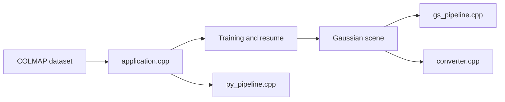

# MrNeRF/LichtFeld-Studio

> Native workstation for training, inspecting, editing and exporting 3D Gaussian Splatting scenes.

## The problem
Training a Gaussian Splatting scene, viewing it and editing it requires chaining separate training scripts and viewers.

## What it actually does
Loads a COLMAP dataset or a checkpoint, trains and resumes, displays the scene in real time (Vulkan rasterizer), edits selections of Gaussians with undo, exports to PLY, SOG, SPZ or an HTML viewer. Automation through Python plugins, embedded Python and MCP tools. POPSpa option to reduce the number of Gaussians.

## How it is wired


## Trying it
```text
--enable-sparsity --popspa-target-count 256000
```
For everything else, the README points to the build wiki.

## Cost and gotchas
NVIDIA GPU with compute capability ≥ 7.5, driver 570+ (CUDA 12.8+). Building is free under GPLv3; Windows binaries come through a paid portal (donation of your choice) that funds the project.

## What it is not
Not compatible with AMD, Intel or GTX 10-series. No binaries on GitHub Releases. A recent NVIDIA GPU is required.

## Alternatives
No alternative named in the README.

## For you
Watch: interesting if you do 3D reconstruction on an NVIDIA GPU; off-topic otherwise. The MCP interface is an automation point worth testing.
