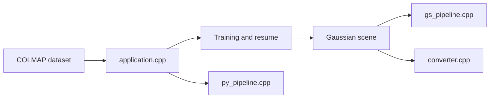

# MrNeRF/LichtFeld-Studio

> Station de travail native pour entraîner, inspecter, éditer et exporter des scènes 3D Gaussian Splatting.

## Le problème
Entraîner une scène de Gaussian Splatting, la visualiser et l'éditer exige de chaîner des scripts d'entraînement et des visualiseurs séparés.

## Ce que ça fait vraiment
Charge un dataset COLMAP ou un checkpoint, entraîne et reprend, affiche la scène en temps réel (rasteriseur Vulkan), édite des sélections de gaussiennes avec annulation, exporte en PLY, SOG, SPZ ou visionneuse HTML. Automatisation par plugins Python, Python embarqué et outils MCP. Option POPSpa pour réduire le nombre de gaussiennes.

## Comment c'est branché


## Essayer
```text
--enable-sparsity --popspa-target-count 256000
```
Pour le reste, le README renvoie au wiki de compilation.

## Coût et pièges
GPU NVIDIA de capacité de calcul ≥ 7.5, pilote 570+ (CUDA 12.8+). Compilation gratuite sous GPLv3 ; binaires Windows via un portail payant (don au choix) qui finance le projet.

## Ce que ce n'est pas
Pas compatible AMD, Intel ni GTX 10-series. Pas de binaires sur GitHub Releases. Il faut un GPU NVIDIA récent.

## Alternatives
Aucune alternative nommée dans le README.

## Pour toi
Surveiller : intéressant si tu fais de la reconstruction 3D sur GPU NVIDIA ; hors sujet sinon. L'interface MCP est un point d'automatisation à tester.

