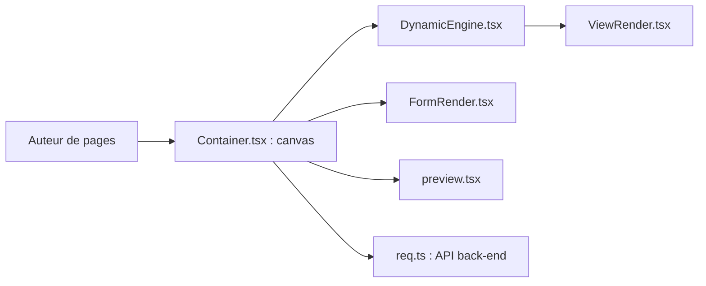

# MrXujiang/h5-Dooring

> Visual low-code editor in React for building H5 pages by drag and drop.

## The problem
Produce mobile promotional pages without a front-end developer.

## What it actually does
Component-based editor (basic, media, products, visuals) with canvas, configuration panel, form designer, animations, interactions, data sources, preview and a template library. A Koa back end handles works, users and form collection. The README points to related products by the author.

## How it is wired


## Trying it
```bash
git clone https://github.com/MrXujiang/h5-Dooring.git
cd ./h5-Dooring
yarn pkg
yarn start
```
Then open http://localhost:port/h5_plus.

## Cost and gotchas
Free. On Windows, the README points to dooring-electron. Documentation and demo partly in Chinese; README stuffed with links to the author's other products.

## What it is not
Not a data visualization tool nor a dashboard. GPL-3.0 license: restrictive for redistribution.

## Alternatives
- V6.Dooring: editor for visualization screens, by the same author.
- dooring-electron-lowcode: desktop version.

## For you
Ignore: marketing page generator, unrelated to data/AI/MLOps.
