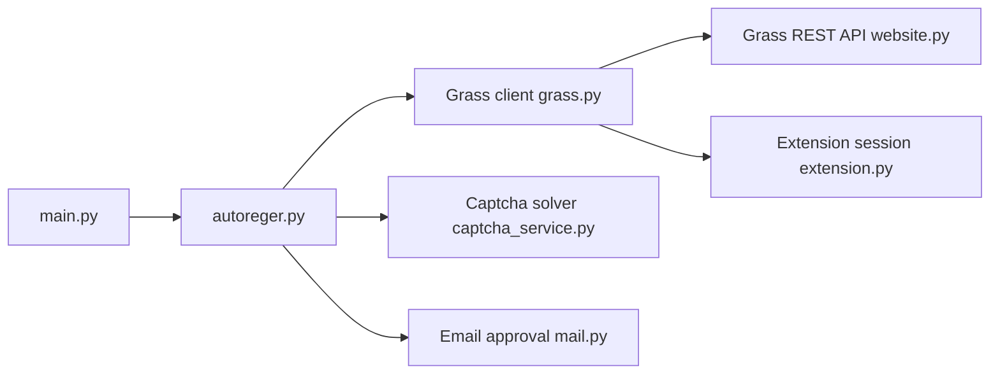

# MsLolita/grass

> Python bot that creates Grass accounts in bulk and accumulates points through proxies, for reward farmers.

## The problem
Accumulating points on the Grass service with many accounts requires automating registration, validation and login.

## What it actually does
Creates accounts (with captcha solving through a paid service), validates them by email via IMAP, links a Solana wallet, then opens extension-style WebSocket sessions to accumulate points. Checks the points. Spreads accounts across proxies stored in a database, with several connections per account possible. Settings through flags in `data/config.py`; optional desktop interface.

## How it is wired


## Trying it
```bash
pip install -r requirements.txt
python main.py
# or: docker-compose up -d
```

## Cost and gotchas
Captcha service (AntiCaptcha or 2Captcha), proxies and emails to be supplied. Solana private keys and email passwords stored in text files: risk of leaks.

## What it is not
Not a data or AI tool: it is automation of a third-party service whose terms of use may forbid multiple accounts and bots.

## Alternatives
The README cites Grass Final Checker and Grass Claimer, by the same author (complements, not alternatives).

## For you
Ignore: of no interest for a data/AI profile, and it handles credentials and wallet keys in plain-text files with a captcha bypass.
