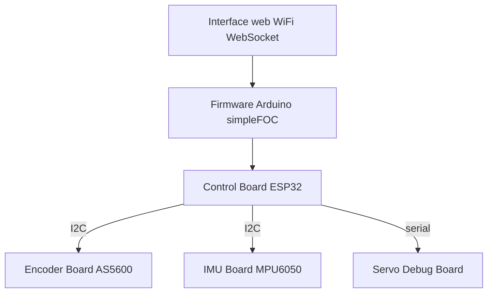

# MuShibo/Micro-Wheeled_leg-Robot

> Plans, boards and code for a small two-wheeled-leg desktop robot, based on ESP32.

## The problem
Building a balanced wheeled biped robot requires mechanics, electronic boards and control loops all at once.

## What it actually does
The repository contains the mechanical model (STEP), the parts to manufacture and to buy, four boards (ESP32 control, AS5600 encoder, MPU6050 IMU, servo debugging) and the Arduino code. The brushless motors use simpleFOC. The robot serves a web control page over WebSocket, in access point mode or as a WiFi client.

## How it is wired


## Trying it
```bash
# Pas de commande : brancher la batterie, appuyer sur EN, se connecter au WiFi WL...,
# puis ouvrir http://192.168.1.11 et cliquer sur « Robot go! ».
```

## Cost and gotchas
Hardware to buy and to manufacture (3D printing, CNC, cutting, four PCBs). No license declared in the catalog. Last push in December 2024. The boards are designed in LCEDA.

## What it is not
Not a ready-to-assemble kit: the parts have to be produced yourself. No AI component: balancing relies on control loops.

## Alternatives
No alternative named in the README.

## For you
Ignore: a hardware robotics project that does not serve data, AI or MLOps work, with no license and little activity.
