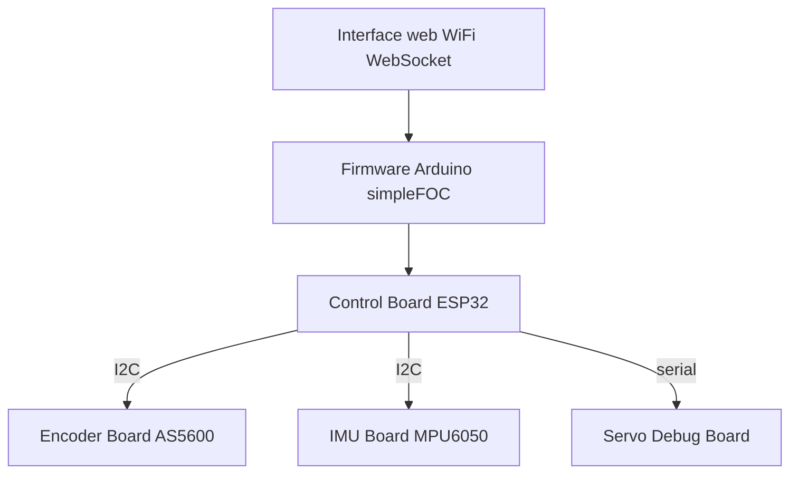

# MuShibo/Micro-Wheeled_leg-Robot

> Plans, cartes et code d'un petit robot de bureau à deux roues sur pattes, basé sur ESP32.

## Le problème
Construire un robot bipède à roues équilibré demande mécanique, cartes électroniques et asservissement à la fois.

## Ce que ça fait vraiment
Le dépôt contient le modèle mécanique (STEP), les pièces à fabriquer et à acheter, quatre cartes (contrôle ESP32, encodeur AS5600, IMU MPU6050, débogage servos) et le code Arduino. Les moteurs sans balais utilisent simpleFOC. Le robot sert une page web de commande par WebSocket, en mode point d'accès ou client WiFi.

## Comment c'est branché


## Essayer
```bash
# Pas de commande : brancher la batterie, appuyer sur EN, se connecter au WiFi WL...,
# puis ouvrir http://192.168.1.11 et cliquer sur « Robot go! ».
```

## Coût et pièges
Matériel à acheter et à fabriquer (impression 3D, CNC, découpe, quatre PCB). Pas de licence déclarée dans le catalogue. Dernier push en décembre 2024. Les cartes sont conçues sous LCEDA.

## Ce que ce n'est pas
Pas un kit prêt à monter : les pièces sont à produire soi-même. Pas de partie IA : l'équilibre repose sur de l'asservissement.

## Alternatives
Aucune alternative nommée dans le README.

## Pour toi
À ignorer : projet de robotique matérielle qui ne sert pas un travail data, IA ou MLOps, sans licence et peu actif.

