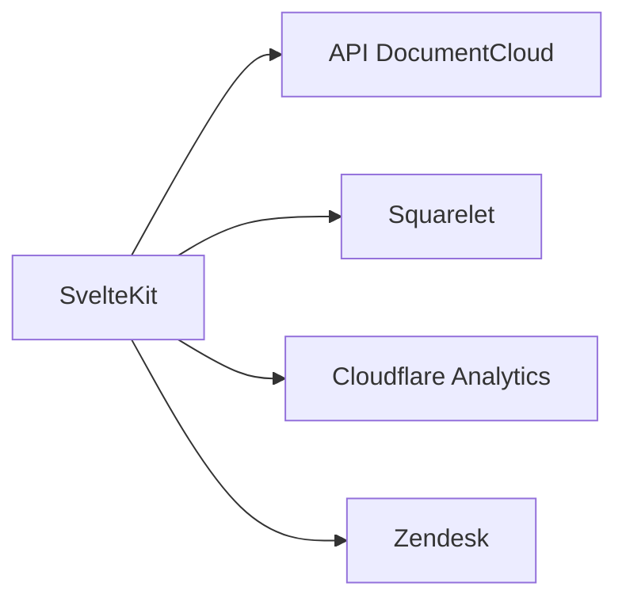

# MuckRock/documentcloud-frontend

> SvelteKit interface of DocumentCloud, a document analysis and publishing platform for journalists.

## The problem
Providing a web interface to browse, annotate and embed documents hosted by the DocumentCloud API.

## What it actually does
A SvelteKit frontend that relies on the DocumentCloud API (Django) and on the Squarelet authentication service. It offers a home page of trending documents (Cloudflare analytics), a feedback form via Zendesk, `iframe` embeds and rewritten legacy embed scripts. Unit tests, Playwright and Storybook included.

## How it is wired
Simplified diagram based on the sheet, no diagram provided.


## Trying it
```bash
make install
make dev
npm run dev:remote
npm run test:unit
npm run test:e2e
```

## Cost and gotchas
You need Squarelet and DocumentCloud running locally, or access to the staging API. A Cloudflare token and Zendesk access are required for two features. AGPL-3.0 license (copyleft), not flagged as an alert for lack of a rule in the values.

## What it is not
Not a document analysis engine: only the interface. Unusable on its own.

## Alternatives
None named in the README.

## For you
Ignore: frontend of a third-party platform, of no value to a data/AI profile outside contributing to the project.
