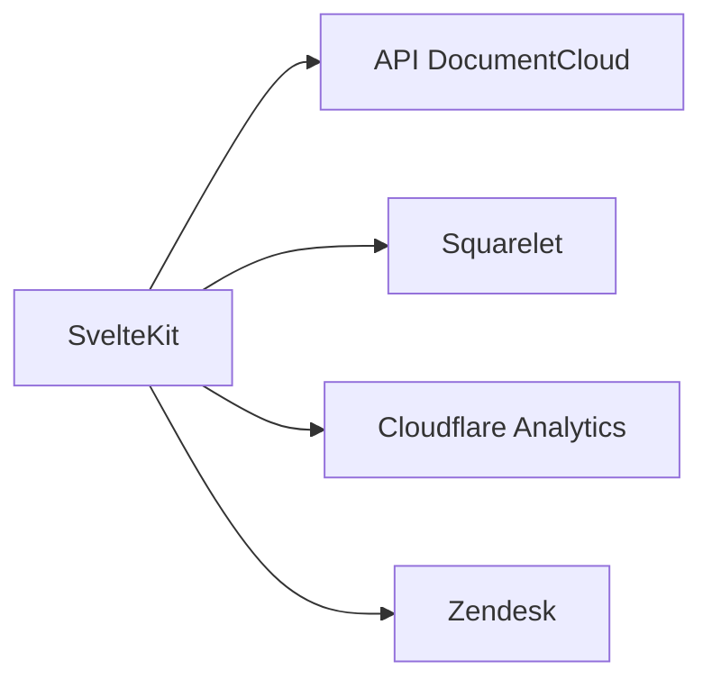

# MuckRock/documentcloud-frontend

> Interface SvelteKit de DocumentCloud, plateforme d'analyse et de publication de documents pour journalistes.

## Le problème
Offrir une interface web pour parcourir, annoter et intégrer des documents hébergés par l'API DocumentCloud.

## Ce que ça fait vraiment
Frontend SvelteKit qui s'appuie sur l'API DocumentCloud (Django) et sur le service d'authentification Squarelet. Il propose une page d'accueil de documents tendance (analytique Cloudflare), un formulaire de retour via Zendesk, des intégrations par `iframe` et des anciens scripts d'intégration réécrits. Tests unitaires, Playwright et Storybook inclus.

## Comment c'est branché
Schéma simplifié d'après la fiche, sans diagramme fourni.


## Essayer
```bash
make install
make dev
npm run dev:remote
npm run test:unit
npm run test:e2e
```

## Coût et pièges
Il faut Squarelet et DocumentCloud lancés en local, ou un accès à l'API de staging. Jeton Cloudflare et accès Zendesk requis pour deux fonctions. Licence AGPL-3.0 (copyleft), non déclarée en alerte faute de règle dans les valeurs.

## Ce que ce n'est pas
Pas un moteur d'analyse de documents : seulement l'interface. Inutilisable seul.

## Alternatives
Aucune nommée dans le README.

## Pour toi
À ignorer : frontend d'une plateforme tierce, sans valeur pour un profil data/IA hors contribution au projet.

