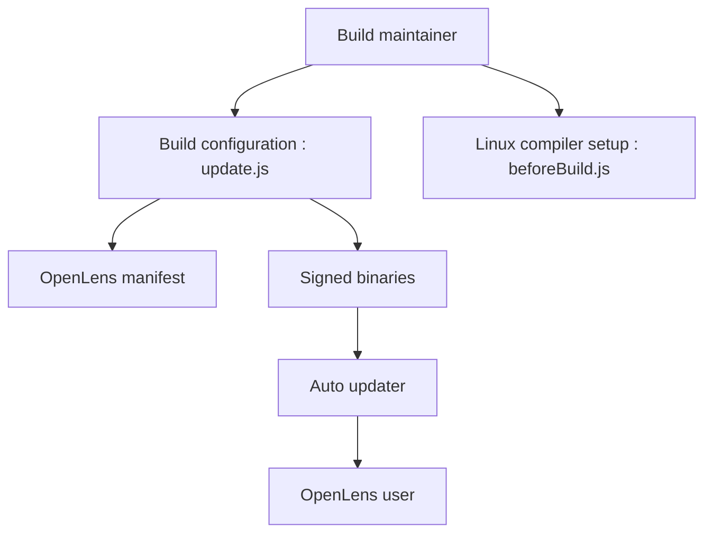

# MuhammedKalkan/OpenLens

> Repository of signed binaries of the open code of Lens, the Kubernetes IDE, with no mandatory login.

## The problem
Lens closed its source code; the open part is no longer distributed as binaries.

## What it actually does
Does not modify the source code: it provides signed OpenLens builds. Judging by the code, small scripts edit the upstream manifest (`update.js`) and choose Linux compilers (`beforeBuild.js`). An auto-updater is announced. Installation via Homebrew, Scoop, Winget, Chocolatey or binaries.

## How it is wired


## Trying it
```bash
brew install --cask openlens
scoop bucket add extras
scoop install openlens
winget install openlens
```

## Cost and gotchas
Free. The README warns that Lens closed its code: no more updates to expect. Last push in May 2024. No license declared on this build repository. Third-party binaries: trust in the maintainer.

## What it is not
Not the Lens code: software problems should be reported to the Lens repository. Not an actively maintained version.

## Alternatives
- Lens IDE: the official Mirantis distribution, under a classic EULA.

## For you
Ignore: frozen since 2024, third-party binaries with no declared license; better to use a maintained Kubernetes client.
