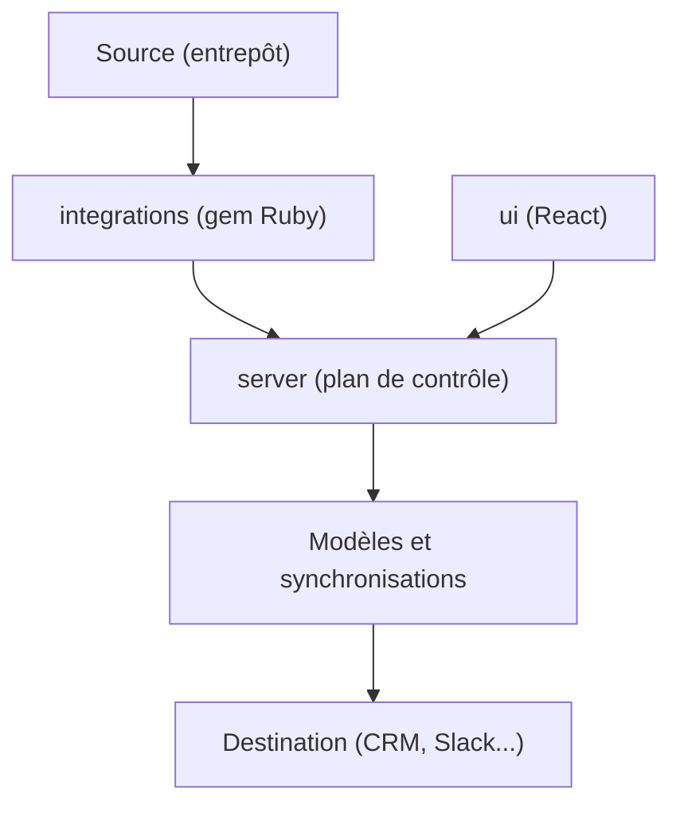

# Multiwoven/multiwoven

> Open reverse ETL platform that syncs the data warehouse to business tools.

## The problem
Clean data stays in the warehouse, while business teams work in Salesforce, HubSpot or Slack.

## What it actually does
A monorepo with three services: a server (control plane for sources, models and syncs), a React interface and a Ruby gem of connectors. Sources: Redshift, BigQuery, Snowflake, Databricks, PostgreSQL. Destinations checked off: Salesforce, HubSpot, Klaviyo, Facebook Ads, Slack, Google Sheets, Airtable.

## How it is wired
Simplified diagram based on the sheet, no diagram provided.



## Trying it
```bash
git clone git@github.com:Multiwoven/multiwoven.git
cd multiwoven
mv .env.example .env
cp .env ui/.env
./git-hooks/setup-hooks.sh
docker-compose build && docker-compose up
# UI sur http://localhost:8000
```

## Cost and gotchas
Free to self-host, AGPL-3.0. You operate the stack yourself. Several deployment targets (EKS, GKE...) are still "coming soon". 213 open issues.

## What it is not
Not an ingestion or transformation tool: it pushes data that is already ready. The project describes itself as under active development, with possible bugs.

## Alternatives
- HighTouch: commercial service that the README cites as a model.
- Census: same, commercial offering.
- RudderStack: same.

## For you
Worth watching: useful for activating tables or scores in business tools, but its stated maturity is partial and the AGPL needs to be validated.
