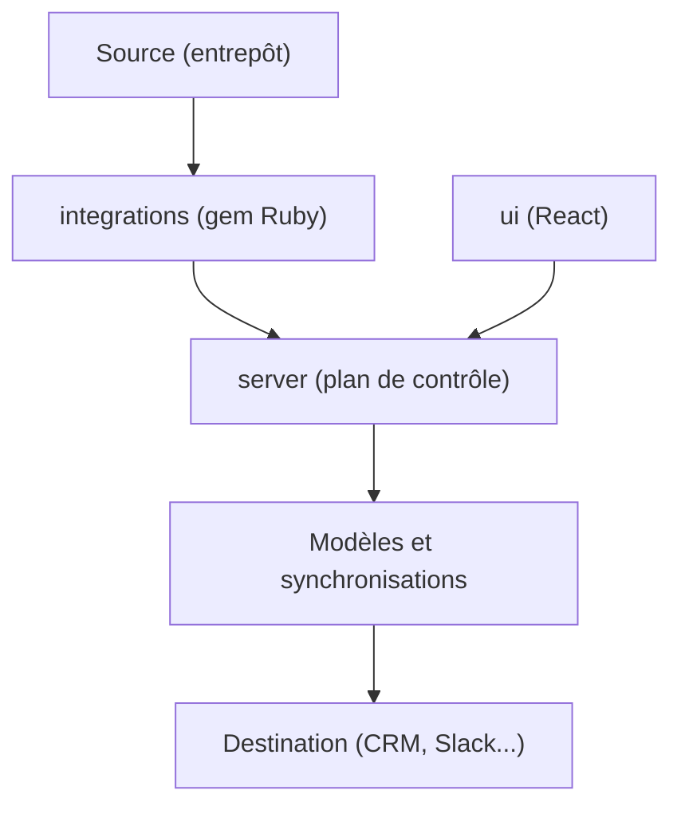

# Multiwoven/multiwoven

> Plateforme libre de reverse ETL qui synchronise l'entrepôt de données vers les outils métier.

## Le problème
Les données propres restent dans l'entrepôt, alors que les équipes métier travaillent dans Salesforce, HubSpot ou Slack.

## Ce que ça fait vraiment
Monorepo en trois services : un serveur (plan de contrôle des sources, modèles et synchronisations), une interface React et un gem Ruby de connecteurs. Sources : Redshift, BigQuery, Snowflake, Databricks, PostgreSQL. Destinations cochées : Salesforce, HubSpot, Klaviyo, Facebook Ads, Slack, Google Sheets, Airtable.

## Comment c'est branché
Schéma simplifié d'après la fiche, sans diagramme fourni.



## Essayer
```bash
git clone git@github.com:Multiwoven/multiwoven.git
cd multiwoven
mv .env.example .env
cp .env ui/.env
./git-hooks/setup-hooks.sh
docker-compose build && docker-compose up
# UI sur http://localhost:8000
```

## Coût et pièges
Gratuit à auto-héberger, AGPL-3.0. Tu opères toi-même la pile. Plusieurs cibles de déploiement (EKS, GKE...) sont encore « bientôt ». 213 issues ouvertes.

## Ce que ce n'est pas
Pas un outil d'ingestion ou de transformation : il pousse des données déjà prêtes. Le projet se dit en développement actif, avec des bugs possibles.

## Alternatives
- HighTouch : service commercial que le README cite comme modèle.
- Census : idem, offre commerciale.
- RudderStack : idem.

## Pour toi
À surveiller : utile pour activer des tables ou des scores dans les outils métier, mais maturité annoncée partielle et AGPL à valider.

